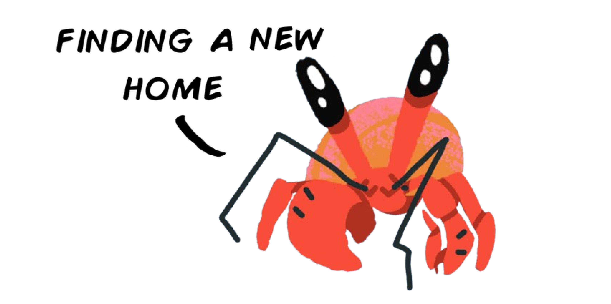

<h1 align="center">HermitLM</h1>

  
  
  
  

  

  

A ~8M parameter LLM that talks like a tiny crab in an aquatic world, chattable entirely in your browser.

## Documentation

The README is an index. Each topic has its own file:

| # | Topic | File |
|---|---|---|
| 01 | Introduction, transcript and how it works | [docs/01-introduction.md](docs/01-introduction.md) |
| 02 | Architecture and parameter count | [docs/02-architecture.md](docs/02-architecture.md) |
| 03 | Features | [docs/03-features.md](docs/03-features.md) |
| 04 | Training (SFT, PPO, DPO) | [docs/04-training.md](docs/04-training.md) |
| 05 | Evaluation | [docs/05-eval.md](docs/05-eval.md) |
| 06 | Tool router | [docs/06-tools.md](docs/06-tools.md) |
| 07 | Decision model and metrics | [docs/07-decision-model.md](docs/07-decision-model.md) |
| 08 | Calibration toolkit | [docs/08-calibration.md](docs/08-calibration.md) |
| 09 | Tool routing details | [docs/09-tool-routing.md](docs/09-tool-routing.md) |
| 10 | Reply quality and analytics | [docs/10-reply-quality.md](docs/10-reply-quality.md) |
| 11 | HTTP API | [docs/11-api.md](docs/11-api.md) |
| 12 | Browser website | [docs/12-website.md](docs/12-website.md) |
| 13 | Hugging Face repos | [docs/13-hugging-face.md](docs/13-hugging-face.md) |
| 14 | Development and tests | [docs/14-development.md](docs/14-development.md) |
| 15 | License | [docs/15-license.md](docs/15-license.md) |

## Quick links

- [15-chapter textbook](chapters/README.md), starting with [the overview](chapters/00_overview.md).
- [Formula and hyperparameter sheet](chapters/14_glossary_math.md).
- [Calibration work status](docs/calibration-improvements.md).
- [Pre-deploy diagnostics](docs/14-development.md) — `python -m hermitlm.tools.check`.
