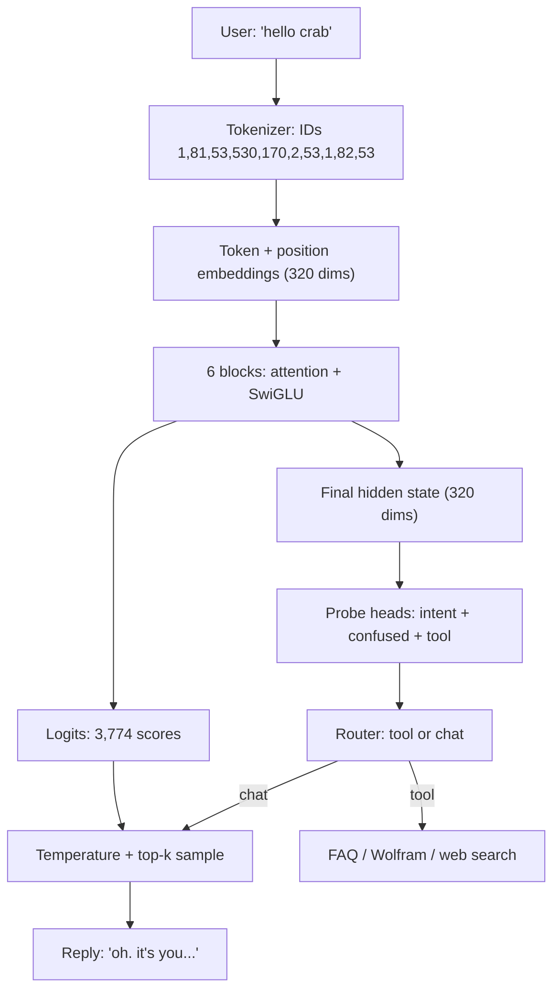
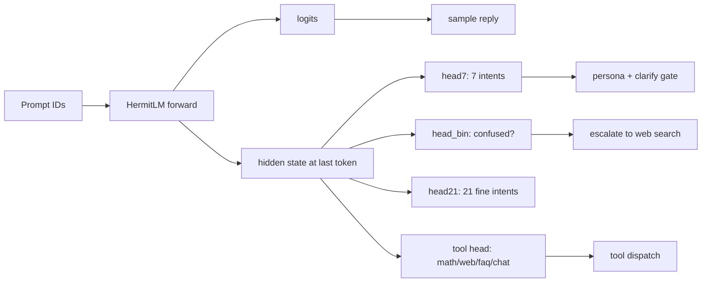

# Chapter 0 — What Even Is HermitLM?

> *"A tiny crab reads your message, checks what you probably mean, then guesses the next word until it has a reply."*

---

## The 5-year-old analogy

Imagine a crab that has read thousands of conversations about aquariums, sand, kelp and being a crab. You say **"hello crab"**. The crab does three things:

1. It cuts your words into small pieces and turns them into numbers.
2. It reads the numbers over and over, asking each word *"which earlier words matter for the next one?"*
3. It guesses the next word, writes it down, and repeats until it decides to stop.

Sometimes the crab does not know a fact. Then it raises a claw and asks a helper: a math tool, a search tool, or a FAQ table. A tiny second brain — the **decision model** — decides which helper to call.

| Concept | In this repo |
|---|---|
| The crab's memory | 8,453,120 numbers called **parameters** |
| Reading a conversation | **6 transformer blocks** over at most **512 tokens** |
| Words it knows | A **byte-level BPE vocabulary of 3,774 tokens** |
| Asking which words matter | **Attention** with 8 heads of 40 dimensions |
| The tiny second brain | **Probe heads** on the frozen final hidden state |
| The helpers | **FAQ, Wolfram math, and web search** |
| Where it lives | Fully in your browser as a **9.2 MB ONNX file** |



---

## What you will build

This textbook follows the code as it exists in the repository today.

| Component | Chapter | What you understand |
|---|---|---|
| Byte-level BPE tokenizer | [2](02_tokenization.md) | How text becomes IDs 0–3,773 |
| Token and position embeddings | [3](03_embeddings.md) | Why the seat number is added to the meaning vector |
| Causal self-attention | [4](04_attention.md) | Why the score is divided by √40 |
| Pre-norm block with SwiGLU | [5](05_transformer_block.md) | Why the residual path is a "gradient highway" |
| Full `HermitLM` | [6](06_gpt_model.md) | Where all 8,453,120 parameters live |
| Training loop | [7](07_training.md) | Masked cross-entropy, AdamW, warmup and cosine decay |
| Generation | [8](08_generation.md) | Temperature, top-k, top-p and stop tokens |
| Tool router | [9](09_tools.md) | Tags, keywords, probes and escalation |
| Decision model | [10](10_decision_model.md) | Linear heads, Platt targets, temperature, ECE |
| PPO and DPO | [11](11_rlhf.md) | Persona reward, clipped objectives, preference pairs |
| ONNX and quantization | [12](12_export_browser.md) | 36.3 MB → 9.2 MB and browser inference |
| Evaluation | [13](13_evaluation.md) | Perplexity 1.929, reward, calibration metrics |

---

## The architecture in one table

From `README.md:48-84` and `checkpoints/config.json`:

| Field | Value |
|---|---|
| Parameters | **8,453,120** unique (9,660,800 in the raw checkpoint file) |
| Layers | 6 transformer blocks |
| Hidden dim (`d_model`) | 320 |
| Attention heads | 8 (40 dims per head) |
| Feed-forward | 800 hidden, SwiGLU with SiLU |
| Vocabulary | 3,774 byte-level BPE tokens |
| Maximum sequence | 512 tokens |
| Normalization | LayerNorm, pre-norm residual blocks |
| Position | Learned embeddings |
| LM head | Weight-tied with the token embedding |
| Dropout | 0.1 during SFT, 0.0 during PPO/DPO |
| Web artifact | uint8 dynamic quantization, 9,215,272 bytes |

### Why the checkpoint has more parameters

`lm_head.weight` is the same tensor as `tok_emb.weight` (`hermitlm/training/model.py:86-87`):

```python
84:        self.lm_head = nn.Linear(config.d_model, config.vocab_size, bias=False)
85:
86:        # weight tying
87:        self.lm_head.weight = self.tok_emb.weight
```

The raw `state_dict` stores that matrix twice. `param_count()` counts unique tensors, so it reports 8,453,120 and the raw sum is 9,660,800. The difference is exactly `3,774 × 320 = 1,207,680`.

Chapter 6 derives the full count, term by term.

---

## What makes this model "tiny"

A modern 8-billion-parameter model stores about 1,000 times more numbers. HermitLM fits in a browser tab because:

- the hidden size is 320, not 4,096 or more
- there are 6 blocks, not 32 or 80
- the vocabulary is 3,774, not 100,000+
- the published artifact is quantized to 8-bit integers

The same operations run at every scale. That is why this model is a good place to learn them.

---

## Two paths through the model

HermitLM is not only a text generator. It has a second, cheap path:



The ONNX export wraps the model so that **one forward pass returns both `logits` and `last_hidden`** (`hermitlm/training/model.py:216-233`). The browser uses the hidden state for classification without downloading a second model.

---

## The shipped data at a glance

| File | Rows | Meaning |
|---|---|---|
| `data/train.jsonl` | 95,000 | crab conversations for SFT |
| `data/eval.jsonl` | 5,000 | held-out conversations |
| `data/human_eval.jsonl` | 126 | 21 fine types × 6 hand-written messages |
| `data/tool_train.jsonl` | 5,038 | tool-routing training data |
| `data/tool_eval.jsonl` | 80 | 20 rows per tool class |

Every SFT row has three keys: `input`, `output`, and `type`. The `type` is one of 21 fine labels such as `greeting`, `food`, `temp_cold`, `breathing`, or `confused`. Chapter 10 maps those 21 labels to 7 coarse intents.

---

## How to read a chapter

When you meet a formula, you will find it in three places:

1. a sentence that says what it is for
2. a worked example with numbers from this repository
3. the exact code lines that implement it

If the math feels heavy, read the worked example first. If the code feels dense, go back to the analogy.

---

**Next:** [Chapter 1 — Setup and repository map](01_setup.md)
