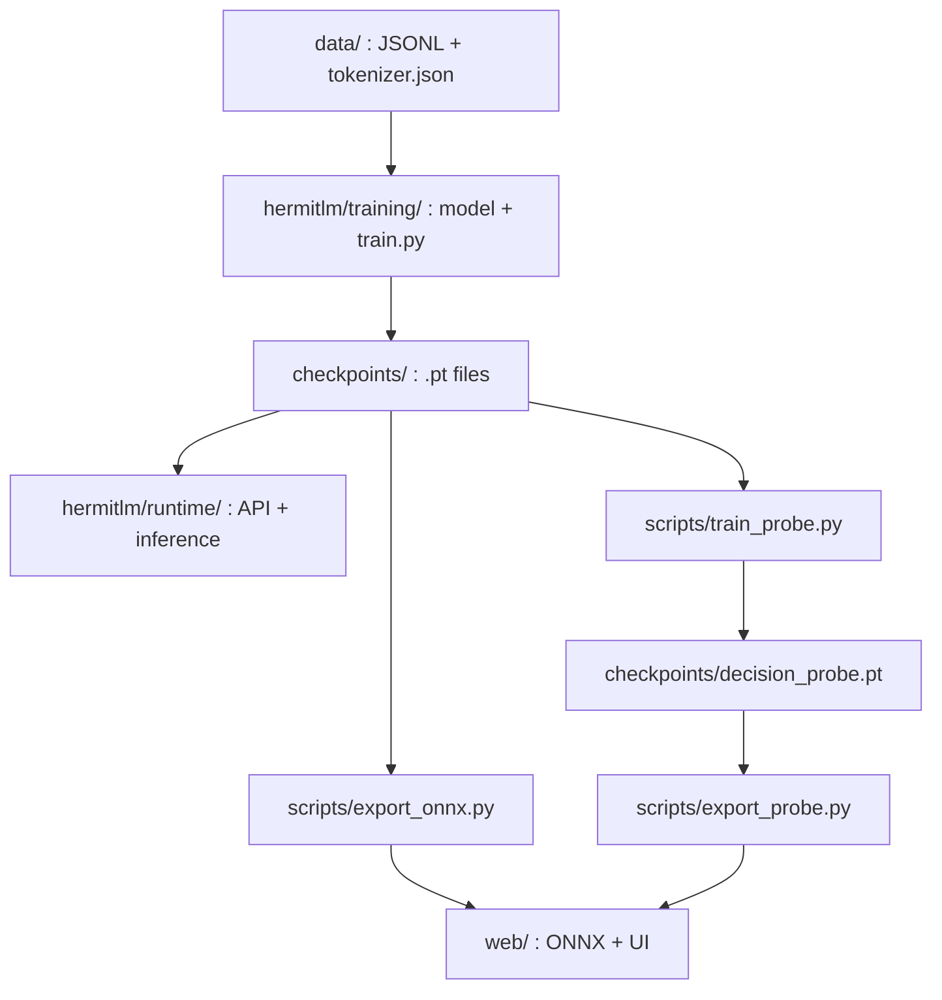
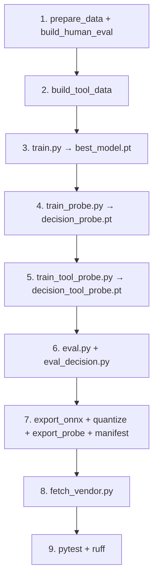

# Chapter 1 — Setup and Repository Map

> *Before you train a crab, you need to know where the crab lives.*

---

## The 5-year-old analogy

Think of the repository as a small workshop. There is a **data shelf** (`data/`), a **workbench** (`hermitlm/training/`), a **toolbox** (`hermitlm/tools/`), a **warehouse** (`checkpoints/`), and a **shop window** (`web/`). Scripts in `scripts/` are the recipes that move things between rooms.



---

## Install

```bash
git clone https://github.com/darshi1337/hermitlm.git
cd hermitlm
python -m venv .venv
source .venv/bin/activate            # Windows: .venv\Scripts\activate
pip install -r requirements.txt
```

The training wheel depends on your accelerator. The repository defaults to an **Intel Arc GPU through PyTorch XPU** (`hermitlm/settings.py:13`):

```python
13: TRAIN_DEVICE = os.getenv("HERMIT_TRAIN_DEVICE", "xpu")
```

| Device | Environment value | Wheel |
|---|---|---|
| Intel Arc | `xpu` (default here) | `pip install torch --index-url https://download.pytorch.org/whl/xpu` |
| NVIDIA | `cuda` | standard CUDA build |
| Apple Silicon | `mps` | standard macOS build |
| Debug only | `cpu` | any build |

`get_device()` in `hermitlm/training/train.py:27-40` refuses to run on an unavailable explicit backend:

```python
33:    device = torch.device(config.device)
34:    if device.type in ("cuda", "xpu") and not accelerator_available(device.type):
35:        raise RuntimeError(
36:            f"Training was requested on {device.type} but that backend is not "
37:            "available. Install the matching PyTorch build and driver, or set "
38:            "HERMIT_TRAIN_DEVICE=cpu for a CPU-only debug run."
39:        )
```

Probe fitting is different. It runs on CPU by default (`scripts/train_probe.py:59-67`) because it is frozen-model inference and XPU can be unreliable there.

---

## Repository map

| Path | Contains |
|---|---|
| `hermitlm/config.py` | `HermitConfig`, `TrainConfig`, `PPOConfig` dataclasses |
| `hermitlm/settings.py` | Environment-driven paths, thresholds, generation defaults |
| `hermitlm/training/model.py` | `Attention`, `FFN`, `Block`, `HermitLM`, `ChatWithHidden` |
| `hermitlm/training/dataset.py` | Chat formatting, token shift, padding, `DataLoader` |
| `hermitlm/training/train.py` | SFT loop, learning-rate schedule, masked loss |
| `hermitlm/training/generate_data.py` | 1,105 lines of crab templates and persona variants |
| `hermitlm/training/natural_data.py` | Hand-written natural paraphrases and perturbations |
| `hermitlm/training/reward.py` | `score_response` persona reward and `context_score` score-head supervision |
| `hermitlm/training/ppo.py`, `dpo.py` | Optional RLHF stages |
| `hermitlm/runtime/inference.py` | `HermitInference`, `chat`, `best_of_n` |
| `hermitlm/runtime/api.py` | FastAPI `/chat`, `/chat/stream`, `/stats/intents` |
| `hermitlm/tools/router.py` | Tool tags, keywords, cascade, confusion escalation |
| `hermitlm/tools/decision_model.py` | Probe classes and `ProbeDecisionModel` |
| `hermitlm/tools/calibration.py`, `heads.py`, `prior.py`, `metrics.py` | Head fitting and evaluation math |
| `scripts/export_onnx.py`, `quantize_onnx.py` | Browser artifacts |
| `scripts/train_probe.py`, `train_tool_probe.py` | Frozen-feature head fitting |
| `scripts/eval.py`, `eval_decision.py` | Evaluation dashboards |
| `web/` | Browser UI, vendored onnxruntime-web, ONNX models |

---

## Data shelf

| File | Rows | Size on disk | Purpose |
|---|---:|---:|---|
| `data/train.jsonl` | 95,000 | 14,754,519 bytes | SFT training |
| `data/eval.jsonl` | 5,000 | 778,444 bytes | Held-out SFT evaluation |
| `data/train_openai.jsonl` | 95,000 | 18 MB | Same rows in `messages` format |
| `data/eval_openai.jsonl` | 5,000 | 956 KB | Same, held out |
| `data/human_eval.jsonl` | 126 | 10,103 bytes | Hand-written intent evaluation |
| `data/tool_train.jsonl` | 5,038 | 258,879 bytes | Tool routing training |
| `data/tool_eval.jsonl` | 80 | 4,524 bytes | Tool routing evaluation |
| `data/tokenizer.json` | 3,774 tokens | 271,020 bytes | Byte-level BPE |

One training row looks like this:

```json
{"input": "hello crab", "output": "oh. it's you...", "type": "greeting"}
```

`hermitlm/training/dataset.py:8-28` turns the three supported row shapes into one chat string. Chapter 2 uses this exact row.

---

## Warehouse: checkpoints

| File | Size | What it holds |
|---|---:|---|
| `checkpoints/best_model.pt` | 33,838,453 bytes | Shipped SFT model, step 24,200, eval loss 0.6541 |
| `checkpoints/final_model.pt` | 34,126,593 bytes | Older 30,000-step run, vocab 2,831 |
| `checkpoints/step_1000.pt` … `step_31000.pt` | ~32 MB each | Periodic saves |
| `checkpoints/decision_probe.pt` | 96,233 bytes | 7-way, binary and 21-way linear heads |
| `checkpoints/decision_tool_probe.pt` | 7,877 bytes | 4-way tool head |
| `checkpoints/ppo/ppo_final.pt` | — | Optional PPO policy |
| `checkpoints/dpo/dpo_final.pt` | — | Optional DPO policy |
| `checkpoints/config.json` | 578 bytes | Hyperparameters of the current run |

> ⚠️ The artifacts span three vocabulary eras: 2,833 (config default), 2,831 (older PPO/DPO/final run) and 3,774 (the shipped tokenizer and best model). Chapter 6 explains how `sync_config_with_tokenizer` resolves this.

---

## Three ways to run the model

### 1. Chat in the terminal

```bash
python -m hermitlm.runtime.inference \
  --checkpoint checkpoints/best_model.pt \
  --tokenizer data/tokenizer.json
```

### 2. Run the API

```bash
uvicorn hermitlm.runtime.api:app --host 0.0.0.0 --port 8000
curl -s localhost:8000/health
curl -s -X POST localhost:8000/chat \
  -H 'content-type: application/json' \
  -d '{"user_id":"demo","message":"hello crab"}'
```

The response contains `response`, `tool`, `intent` and `persona` (`hermitlm/runtime/api.py:58-70`).

### 3. Use the browser

```bash
python -m http.server 8000
# open http://localhost:8000/web/
```

The page downloads `model.quant.onnx`, `tokenizer.json` and `probe.json`, then runs everything locally.

> The local `web/` folder currently contains an older ONNX with a 2,831-token vocabulary. The deploy workflow regenerates all web artifacts from the current checkpoint. Chapter 12 covers this mismatch.

---

## The retrain pipeline

`scripts/retrain_all.sh` and `scripts/retrain_all.ps1` run nine stages:



On Windows, `scripts/retrain_resume.ps1` records finished steps in `eval_out/retrain_done.txt` and skips them on the next run. `scripts/install_retrain_task.ps1` registers a logon task named `HermitLM Retrain (XPU)`.

> ⚠️ Both retrain scripts pass `--epochs 30` to the probe trainers, but neither `train_probe.py` nor `train_tool_probe.py` defines that flag. The probes are closed-form ridge/LDA fits, so there are no epochs to set. Remove the flag before running those stages.

---

## Math and calculations: artifact sizes

Byte counts come from `stat` on the checked-in files.

| Quantity | Calculation | Result |
|---|---|---|
| fp32 ONNX | 36,282,163 bytes ÷ 1e6 | 36.28 MB decimal |
| uint8 ONNX | 9,215,272 bytes ÷ 1e6 | 9.22 MB decimal |
| Size ratio | 36,282,163 ÷ 9,215,272 | 3.94× smaller |
| Space saved | 1 − 9,215,272 ÷ 36,282,163 | 74.6% |
| Checkpoint bytes per parameter | 33,838,453 ÷ 9,660,800 raw params | 3.50 bytes/param |
| Training rows per batch | 95,000 ÷ 32 | 2,968.75 batches/epoch |

The checkpoint stores float32 tensors plus optimizer-free metadata, which is why 4 bytes per parameter plus overhead is close to the file size.

---

## Verify your setup

```bash
python -c "import torch; print(torch.__version__)"
python -m hermitlm.tools.check
pytest -q
ruff check .
```

The repository records 111 passed and 2 skipped tests. `python -m hermitlm.tools.check` validates token IDs, batch consistency, hidden layers, prompt-template hashes and artifact selection before a deploy.

---

**Next:** [Chapter 2 — Tokenization](02_tokenization.md)
