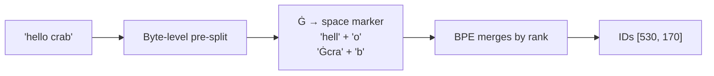

# Chapter 2 — Tokenization: From Words to Numbers

> *A tokenizer is a pair of scissors. It cuts text into pieces that the model has learned to recognize.*

---

## The 5-year-old analogy

A model cannot read letters. It only understands whole numbers. So before any text reaches the crab, a **tokenizer** cuts the text into small pieces and gives each piece a number.

Think of a box of 3,774 labeled Lego bricks. Most bricks are pieces of words (`hell`, `o`, `Ġcrab`). A few are special bricks: `<pad>`, `<|im_start|>` and `<|im_end|>`. The tokenizer finds the shortest description of your message using those bricks.

**Byte-level** means the smallest ingredients are the 256 possible bytes. Any text, even an emoji, can be rebuilt from them.



---

## The vocabulary on disk

`data/tokenizer.json` has:

| Property | Value |
|---|---|
| Model type | BPE |
| Vocabulary size | **3,774** tokens |
| Merge rules | **3,719** |
| Pre-tokenizer | ByteLevel, `add_prefix_space: false` |
| Special tokens | `<pad>` = 0, `<|im_start|>` = 1, `<|im_end|>` = 2 |
| Post-processor | TemplateProcessing (the chat wrappers are added by our code) |
| Truncation / padding | none in the tokenizer itself |

The browser has its own dependency-free implementation in `web/tokenizer.js:42-179`. Its split pattern (`web/tokenizer.js:7-8`) is the GPT-2 rule:

```javascript
 7: const SPLIT_PATTERN =
 8:   /'s|'t|'re|'ve|'m|'ll|'d| ?\p{L}+| ?\p{N}+| ?[^\s\p{L}\p{N}]+|\s+(?!\S)|\s+/gu;
```

This keeps contractions together (`'s`, `'t`) and groups letters, numbers and punctuation separately. A leading space stays attached to the following word as the special character `Ġ` (Unicode U+0120).

---

## Byte-level BPE, step by step

`hermitlm/training/prepare_data.py:13-34` trains the tokenizer:

```python
13: def train_tokenizer(texts, save_path, vocab_size=4096):
...
     tokenizer = Tokenizer(BPE(unk_token=None, byte_fallback=False))
     tokenizer.pre_tokenizer = pre_tokenizers.ByteLevel(add_prefix_space=False)
     trainer = trainers.BpeTrainer(
         vocab_size=vocab_size,
         min_frequency=1,
         special_tokens=SPECIAL_TOKENS,
     )
```

Requested size was 4,096. The shipped file has 3,774 tokens because training stopped when no more useful merges existed.

A BPE merge rule is a pair of pieces that may be joined. The pair with the **lowest rank** is joined first. Two real rules from the file:

| Merge | Rank | Resulting token | ID |
|---|---:|---|---:|
| `hell` + `o` | 475 | `hello` | 530 |
| `Ġcra` + `b` | 115 | `Ġcrab` | 170 |
| `Ġ` + `hello` | 1,756 | `Ġhello` | 1,811 |

So `hello crab` becomes `[530, 170]`: the word `hello` and the space-attached word `crab`.

---

## Worked example: a real chat prompt

`hermitlm/runtime/inference.py:81-86` builds the prompt:

```python
81:    def _format_prompt(self, user_input):
82:        return (
83:            "<|im_start|>user\n"
84:            f"{user_input}<|im_end|>\n"
85:            "<|im_start|>assistant\n"
86:        )
```

For `user_input = "hello crab"` the string is:

```text
<|im_start|>user
hello crab<|im_end|>
<|im_start|>assistant
```

Encoding it piece by piece gives **10 token IDs**:

| # | Piece | ID | Why |
|---:|---|---:|---|
| 1 | `<|im_start|>` | 1 | added special token |
| 2 | `user` | 81 | single word token |
| 3 | `\n` | 53 | newline byte |
| 4 | `hello` | 530 | merge of `hell`+`o` |
| 5 | `Ġcrab` | 170 | space + `crab` |
| 6 | `<|im_end|>` | 2 | added special token |
| 7 | `\n` | 53 | newline byte |
| 8 | `<|im_start|>` | 1 | added special token |
| 9 | `assistant` | 82 | single word token |
| 10 | `\n` | 53 | newline byte |

```text
ids = [1, 81, 53, 530, 170, 2, 53, 1, 82, 53]
len(ids) = 10
```

Other verified encodings from the same vocabulary:

| Text | IDs |
|---|---|
| `hello` | `[530]` |
| ` crab` | `[170]` |
| `hello crab` | `[530, 170]` |
| `i am a crab` | `[34, 370, 85, 170]` |
| `the` | `[194]` |

---

## From dataset row to training pair

`hermitlm/training/dataset.py:8-28` formats three accepted row shapes. An `input`/`output` row becomes:

```python
14:    elif "input" in data and "output" in data:
15:        return (
16:            f"<|im_start|>user\n{data['input']}<|im_end|>\n"
17:            f"<|im_start|>assistant\n{data['output']}<|im_end|>"
18:        )
```

For the earlier row `{"input": "hello crab", "output": "oh. it's you...", "type": "greeting"}` the formatted text is:

```text
<|im_start|>user
hello crab<|im_end|>
<|im_start|>assistant
oh. it's you...<|im_end|>
```

`HermitDataset.__init__` (`dataset.py:41-63`) encodes it, wraps bare `text` rows in BOS/EOS, truncates to `max_len = 512`, and keeps rows with at least two IDs.

### The one-token shift

`dataset.py:68-77` creates the training pair:

```python
68:    def __getitem__(self, idx):
69:        ids = self.samples[idx]
70:
71:        x = ids[:-1]
72:        y = ids[1:]
```

For our 10-token prompt example:

| Position | `x[t]` | `y[t]` | Meaning |
|---:|---:|---:|---|
| 0 | 1 | 81 | from `<|im_start|>` predict `user` |
| 1 | 81 | 53 | from `user` predict newline |
| 2 | 53 | 530 | from newline predict `hello` |
| 3 | 530 | 170 | from `hello` predict `Ġcrab` |
| 4 | 170 | 2 | from `Ġcrab` predict `<|im_end|>` |
| 5 | 2 | 53 | from `<|im_end|>` predict newline |
| 6 | 53 | 1 | from newline predict `<|im_start|>` |
| 7 | 1 | 82 | from `<|im_start|>` predict `assistant` |
| 8 | 82 | 53 | from `assistant` predict newline |

The model never sees `y[t]`. It sees `x[0..t]` and must guess `y[t]`. This is the whole training objective.

---

## Padding and the attention mask

`dataset.py:79-93` pads a batch to its longest row and builds a mask:

```python
84:    padded_x = torch.full((len(xs), max_len), pad_id, dtype=torch.long)
86:    attention_mask = torch.zeros((len(xs), max_len), dtype=torch.long)
...
91:        attention_mask[i, :len(x)] = 1
```

| Item | Shape | Meaning |
|---|---|---|
| `padded_x` | `(B, T)` | token IDs with zeros at the end |
| `padded_y` | `(B, T)` | shifted targets with zeros at the end |
| `attention_mask` | `(B, T)` | 1 for real tokens, 0 for padding |

For a batch of two rows of lengths 10 and 7, `T = 10`. The second row has `attention_mask = [1,1,1,1,1,1,1,0,0,0]`. The loss divides by the total number of ones, so padding never changes the answer.

> Padding is **right** padding. `README.md:210-211` records that left padding once cost 30 points of probe accuracy, because learned position embeddings see the wrong positions.

---

## Math and calculations

### Merit of a merge

BPE greedily joins the most frequent adjacent pair. For a pair `(a,b)` with count `c(a,b)` over all adjacent pairs, the chosen merge is:

$$ \Large merge* = \arg\max_{a,b} c(a,b) $$

The rank stored in `tokenizer.json` is the order of those choices. At inference, the tokenizer repeatedly picks the allowed merge with the **smallest rank**.

### Vocabulary coverage

$$ \Large vocab size = special tokens + base bytes + learned merges $$

$$ \Large 3,774 = 3 + 52 + 3,719 $$

The 52 base byte symbols are the single-character tokens visible in `vocab`. The remaining 256 − 52 byte values only appear inside longer tokens, which is why the vocabulary has fewer than `3 + 256 + 3,719` entries.

### Sequence length budget

$$ \Large \text{max seq len} = 512 $$

$$ \Large \text{prompt} = 10\text{ tokens} $$

$$ \Large \text{reply budget} = 502\text{ tokens} $$

$$ \Large \text{runtime max} = 80 $$

`hermitlm/runtime/inference.py:177` truncates generation context to the last 512 tokens, so a long chat keeps only its most recent part.

---

## Code you should remember

| File and lines | What it does |
|---|---|
| `web/tokenizer.js:7-8` | The byte-level split pattern |
| `data/tokenizer.json` | 3,774 vocab entries and 3,719 merge rules |
| `hermitlm/runtime/inference.py:81-86` | Chat prompt template |
| `hermitlm/training/dataset.py:8-28` | Three row formats → one chat string |
| `hermitlm/training/dataset.py:68-77` | The `x = ids[:-1]`, `y = ids[1:]` shift |
| `hermitlm/training/dataset.py:79-93` | Right padding and attention mask |
| `hermitlm/training/train.py:63-81` | Sync config IDs from the tokenizer |

---

**Next:** [Chapter 3 — Embeddings and positions](03_embeddings.md)
