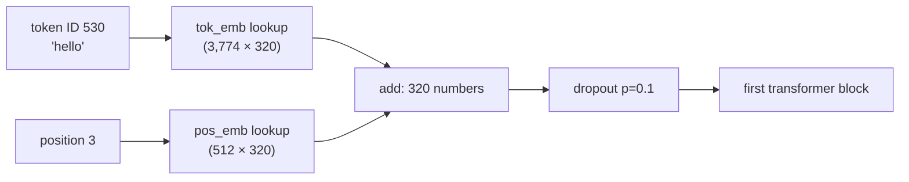
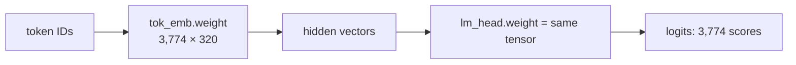

# Chapter 3 — Embeddings and Positions

> *A token ID is just a number. An embedding turns that number into a place in a 320-dimensional room.*

---

## The 5-year-old analogy

Imagine every Lego brick from chapter 2 gets two stickers:

1. a **meaning sticker**: where this piece belongs in a big room of ideas
2. a **seat sticker**: which position it occupies in the sentence

The model adds the two stickers together. Now the same word in two different seats has two slightly different vectors, so the model can tell "crab" at the start from "crab" at the end.



---

## The two embedding tables

`hermitlm/training/model.py:73-76`:

```python
73:        self.tok_emb = nn.Embedding(config.vocab_size, config.d_model)
74:        self.pos_emb = nn.Embedding(config.max_seq_len, config.d_model)
75:
76:        self.drop = nn.Dropout(config.dropout)
```

With the shipped config:

| Table | Shape | Parameters | Calculation |
|---|---|---:|---|
| `tok_emb` | 3,774 × 320 | 1,207,680 | 3,774 × 320 |
| `pos_emb` | 512 × 320 | 163,840 | 512 × 320 |
| **Both** | — | **1,371,520** | 1,207,680 + 163,840 |

That is 16.2% of all 8,453,120 parameters. Chapter 6 accounts for the other 83.8%.

---

## The forward pass: adding meaning to position

`model.py:110-120`:

```python
110:    def forward(self, idx, targets=None, return_hidden=False):
111:        _B, T = idx.shape
112:
113:        pos = torch.arange(0, T, device=idx.device)
114:
115:        x = self.tok_emb(idx) + self.pos_emb(pos)
116:        x = self.drop(x)
117:
118:        # causal mask
119:        mask = torch.tril(torch.ones(T, T, device=idx.device)).bool()
120:        mask = mask.unsqueeze(0).unsqueeze(0)
```

Using the 10-token prompt from chapter 2:

| Step | Shape | Values |
|---|---|---|
| `idx` | `(1, 10)` | `[1, 81, 53, 530, 170, 2, 53, 1, 82, 53]` |
| `pos` | `(10,)` | `[0, 1, 2, 3, 4, 5, 6, 7, 8, 9]` |
| `tok_emb(idx)` | `(1, 10, 320)` | one 320-vector per token ID |
| `pos_emb(pos)` | `(1, 10, 320)` | one 320-vector per seat |
| `x` | `(1, 10, 320)` | element-wise sum |

The addition is broadcast: position 0's vector is added to every batch row at sequence position 0, position 1's vector to position 1, and so on.

### A tiny numeric picture

The real vectors have 320 entries. A three-dimensional toy version shows the idea:

```text
tok_emb("hello") = [0.8, -0.2, 0.5]
pos_emb(3)       = [0.1,  0.4, -0.3]
x(3)             = [0.9,  0.2,  0.2]
```

The same `hello` at position 7 would use `pos_emb(7)` instead, producing a different `x`.

---

## Initialization: how small are the starting numbers?

`model.py:91-98`:

```python
91:    def _init_weights(self, m):
92:        if isinstance(m, nn.Linear):
93:            nn.init.normal_(m.weight, mean=0.0, std=0.02)
...
97:        elif isinstance(m, nn.Embedding):
98:            nn.init.normal_(m.weight, mean=0.0, std=0.02)
```

Every embedding starts as an independent sample from a normal distribution with:

$$
\begin{aligned}
\text{mean} = 0 \\
\text{standard deviation} = \sigma = 0.02 \\
\text{variance} = \sigma^2 = 0.0004
\end{aligned}
$$

About 68% of starting values land in `[−0.02, 0.02]` and about 95% in `[−0.04, 0.04]`. Training moves them from these small random values to useful directions.

---

## Dropout

`self.drop = nn.Dropout(0.1)` (`model.py:76`) randomly sets each of the 320 numbers in each position to zero with probability 0.1 during training, and scales the survivors by `1/(1−0.1) = 1.111…`.

For a 10-token prompt that is `10 × 320 = 3,200` values, so roughly 320 are zeroed on each forward pass. At evaluation time dropout is off (`model.eval()` in `runtime/inference.py:32`), so all values are used.

PPO and DPO force `dropout = 0.0` so old and new log-probabilities stay comparable. See `hermitlm/training/ppo.py:319` and `hermitlm/training/dpo.py:133`.

---

## Weight tying: one table, two jobs

`model.py:84-87`:

```python
84:        self.lm_head = nn.Linear(config.d_model, config.vocab_size, bias=False)
85:
86:        # weight tying
87:        self.lm_head.weight = self.tok_emb.weight
```

The same 3,774 × 320 matrix is used:

- by `tok_emb` to turn an ID into a vector
- by `lm_head` to turn the final hidden vector into 3,774 logits



### Why tie?

1. It removes 1,207,680 parameters, about 12.5% of the raw checkpoint.
2. The model must use the same geometry for reading and writing words, which acts as a regularizer.

The cost: `param_count()` must count unique tensors. `model.py:208-209` does exactly that:

```python
208:    def param_count(self):
209:        return sum(p.numel() for p in self.parameters())
```

PyTorch returns the tied weight once, so the answer is 8,453,120, not 9,660,800.

---

## A vocabulary mismatch to know about

`hermitlm/config.py:6` still declares `vocab_size: int = 2833`, and the older web artifacts use 2,831. The shipped tokenizer has 3,774. `hermitlm/training/train.py:63-81` repairs this at startup:

```python
63: def sync_config_with_tokenizer(config, tokenizer_path):
64:     tokenizer = Tokenizer.from_file(tokenizer_path)
65:     vocab_size = tokenizer.get_vocab_size()
66:
67:     if config.vocab_size != vocab_size:
68:         print(
69:             f"Tokenizer vocab size is {vocab_size}; "
70:             f"overriding config vocab_size={config.vocab_size}"
71:         )
72:         config.vocab_size = vocab_size
```

It also overwrites `pad_id`, `bos_id` and `eos_id` from the tokenizer's special tokens. The same override happens in `runtime/inference.py:21-28` and in the probe loader.

---

## Math and calculations

### Embedding parameter count

$$
\begin{aligned}
P_{\text{tok}} = 3{,}774 \times 320 = 1{,}207{,}680 \\
P_{\text{pos}} = 512 \times 320 = 163{,}840 \\
P_{\text{emb}} = 1{,}371{,}520
\end{aligned}
$$

### Fraction of the model

$$
\begin{aligned}
1,371,520 / 8,453,120 = 0.16225 \to 16.2\%
\end{aligned}
$$

### Saved by weight tying

$$
\begin{aligned}
\text{untied count} = 8{,}453{,}120 + 1{,}207{,}680 = 9{,}660{,}800 \\
\text{saved fraction} = 1{,}207{,}680 / 9{,}660{,}800 = 12.5\%
\end{aligned}
$$

### Dropout scaling

With keep probability `p_keep = 0.9`, surviving activations are multiplied by:

$$
\begin{aligned}
1 / p_{\text{keep}} = 1 / 0.9 = 1.111\ldots
\end{aligned}
$$

This keeps the expected value of the layer unchanged during training.

### Values seen by the model

$$
\begin{aligned}
\text{tokens per batch} = 32 \times 512 = 16{,}384 \\
\text{values before dropout} = 16{,}384 \times 320 = 5{,}242{,}880 \\
\text{expected zeros} = 524{,}288
\end{aligned}
$$

Real rows are short (about 20 words, well under 512 tokens), so the true number is smaller.

---

## Code you should remember

| File and lines | What it does |
|---|---|
| `hermitlm/training/model.py:73-76` | The two embedding tables and dropout |
| `hermitlm/training/model.py:110-120` | Embedding lookup, addition, causal mask |
| `hermitlm/training/model.py:84-87` | Weight tying |
| `hermitlm/training/model.py:91-98` | Normal initialization with σ = 0.02 |
| `hermitlm/training/train.py:63-81` | Override IDs from the tokenizer |

---

**Next:** [Chapter 4 — Attention](04_attention.md)
