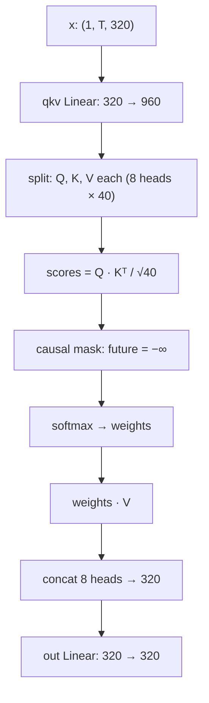

# Chapter 4 — Attention: The Secret Sauce

> *Attention is how one word asks every earlier word: "how much do you matter to me right now?"*

---

## The 5-year-old analogy

You are at a noisy party and someone says **"the crab near it was hungry"**. To understand **"it"**, you look back at the earlier words. You ignore most of them and focus on **"crab"** and **"glass"**. That is attention: a weighted look-back over everything you have already read.

In HermitLM, every position creates three vectors:

| Vector | Question it asks |
|---|---|
| **Query (Q)** | "What am I looking for?" |
| **Key (K)** | "What do I have to offer?" |
| **Value (V)** | "Here is my actual content." |

A query is compared with all keys. High match means high attention weight. The output is a weighted mixture of the values.



---

## The code, line by line

`hermitlm/training/model.py:9-38`:

```python
 9: class Attention(nn.Module):
10:     def __init__(self, config):
11:         super().__init__()
12:         self.n_heads = config.n_heads
13:         self.head_dim = config.d_model // config.n_heads
14:
15:         self.qkv = nn.Linear(config.d_model, 3 * config.d_model)
16:         self.out = nn.Linear(config.d_model, config.d_model)
17:         self.dropout = nn.Dropout(config.dropout)
```

With `d_model = 320` and `n_heads = 8`:

$$ \Large \text{head dim} = 320 / 8 = 40 $$

$$ \Large W_{\text{qkv}} = (3 \times 320) \times 320 = 307{,}200 $$

$$ \Large \text{qkv bias} = 960 $$

$$ \Large \text{total qkv} = 308{,}160 $$

The forward pass (`model.py:19-38`):

```python
19:     def forward(self, x, mask=None):
20:         B, T, C = x.shape
21:
22:         qkv = self.qkv(x).view(B, T, 3, self.n_heads, self.head_dim)
23:         qkv = qkv.permute(2, 0, 3, 1, 4)
24:
25:         q, k, v = qkv[0], qkv[1], qkv[2]
26:
27:         attn = (q @ k.transpose(-2, -1)) / math.sqrt(self.head_dim)
28:
29:         if mask is not None:
30:             attn = attn.masked_fill(~mask, float("-inf"))
31:
32:         attn = F.softmax(attn, dim=-1)
33:         attn = self.dropout(attn)
34:
35:         out = attn @ v
36:         out = out.transpose(1, 2).contiguous().view(B, T, C)
37:
38:         return self.out(out)
```

Shapes through one layer:

| Step | Shape |
|---|---|
| `x` | `(B, T, 320)` |
| `self.qkv(x)` | `(B, T, 960)` |
| `.view(B, T, 3, 8, 40)` | `(B, T, 3, 8, 40)` |
| `.permute(2,0,3,1,4)` | `(3, B, 8, T, 40)` |
| `q`, `k`, `v` | each `(B, 8, T, 40)` |
| `q @ kᵀ` | `(B, 8, T, T)` |
| `attn @ v` | `(B, 8, T, 40)` |
| concat + `self.out` | `(B, T, 320)` |

---

## Why divide by √40?

If query and key components each have variance 1 and are independent, their dot product over `d` dimensions has variance `d`. With `d = 40`, the raw scores have standard deviation `√40 ≈ 6.32`.

Softmax with very large scores becomes nearly one-hot. One weight goes to 1, all others to 0, and the gradient that would adjust the other weights vanishes. Dividing by `√d` restores variance 1 before the softmax:

$$ \Large \text{Var}(q \cdot k) = d $$

$$ \Large \text{Var}((q \cdot k)/\sqrt{d}) = 1 $$

In this model the embeddings start with σ = 0.02 (chapter 3), so raw scores are small at first. The scaling still matters as training grows the vector magnitudes.

---

## The causal mask

`model.py:118-120` builds an upper-triangular mask of allowed positions:

```python
118:        # causal mask
119:        mask = torch.tril(torch.ones(T, T, device=idx.device)).bool()
120:        mask = mask.unsqueeze(0).unsqueeze(0)
```

For `T = 4`, the mask is:

```text
        key 0  1  2  3
query 0   1  0  0  0
       1   1  1  0  0
       2   1  1  1  0
       3   1  1  1  1
```

`masked_fill(~mask, -inf)` (`model.py:30`) sets disallowed scores to negative infinity. After softmax they become exactly 0. Position `t` can attend only to positions `0..t`. This is what makes the model **causal**: it cannot peek at future tokens.

---

## Worked example: one head, by hand

The real head has 40 dimensions. For arithmetic we shrink it to 4. We use three tokens and the vectors below.

```text
       Q                    K                    V
0  [ 1.0, 0.0, 0.5, 0.0] [ 0.6,-0.3, 0.2, 0.1] [ 0.4, 0.9,-0.1, 0.2]
1  [-0.2, 0.8, 0.1, 0.3] [ 0.1, 0.5,-0.2, 0.4] [-0.3, 0.2, 0.5, 0.1]
2  [ 0.5,-0.4, 0.2, 0.6] [-0.4, 0.8, 0.3,-0.1] [ 0.7,-0.1, 0.3,-0.2]
```

### Step 1 — raw scores

For token 2 looking at token 1:

$$ \Large Q_{2} \cdot K_{1} = 0.5\times 0.1 + (-0.4)\times 0.5 + 0.2\times (-0.2) + 0.6\times 0.4 $$

$$ \Large = 0.05 - 0.20 - 0.04 + 0.24 $$

$$ \Large = 0.05 $$

All scores for the three queries:

| Query | K₀ | K₁ | K₂ |
|---|---:|---:|---:|
| 0 | 0.700 | 0.000 | −0.250 |
| 1 | −0.310 | 0.480 | 0.720 |
| 2 | 0.520 | 0.050 | −0.520 |

### Step 2 — scale by √4 = 2

| Query | K₀ | K₁ | K₂ |
|---|---:|---:|---:|
| 0 | 0.350 | 0.000 | −0.125 |
| 1 | −0.155 | 0.240 | 0.360 |
| 2 | 0.260 | 0.025 | −0.260 |

### Step 3 — apply the causal mask

For query 1, the score to key 2 becomes `−∞`. For query 0, scores to keys 1 and 2 become `−∞`.

### Step 4 — softmax

For query 1 the surviving scores are `−0.155` and `0.240`:

$$ \Large e^{-0.155} = 0.8565 $$

$$ \Large e^{ 0.240} = 1.2712 $$

$$ \Large sum = 2.1277 $$

$$ \Large weights = [0.8565/2.1277, 1.2712/2.1277] = [0.4025, 0.5975] $$

Query 1 pays about 40% attention to token 0 and 60% to itself.

| Query | w₀ | w₁ | w₂ |
|---|---:|---:|---:|
| 0 | 1.0000 | 0 | 0 |
| 1 | 0.4025 | 0.5975 | 0 |
| 2 | 0.4193 | 0.3315 | 0.2493 |

### Step 5 — weighted sum of values

For query 1:

$$ \Large out_{1} = 0.4025 \times V_{0} + 0.5975 \times V_{1} $$

$$ \Large = 0.4025 \times [0.4, 0.9,-0.1,0.2] + 0.5975 \times [-0.3,0.2,0.5,0.1] $$

$$ \Large = [0.1610, 0.3623,-0.0403,0.0805] + [-0.1793,0.1195,0.2988,0.0598] $$

$$ \Large = [-0.0182, 0.4818, 0.2585, 0.1403] $$

This 4-vector is the new representation of token 1 after this head. Eight heads compute eight such vectors, which are concatenated back into 320 dimensions.

---

## Math and calculations

### Multi-head split

$$ \Large d_{\text{model}} = n_{\text{heads}} \times d_{\text{head}} = 8 \times 40 = 320 $$

Each head sees a 40-dimensional slice. Together they cover all 320 dimensions.

### Parameter count per block

$$ \Large \text{qkv layer} = 320 \times 960 + 960 = 308{,}160 $$

$$ \Large \text{out layer} = 320 \times 320 + 320 = 102{,}720 $$

$$ \Large \text{total per block} = 410{,}880 $$

$$ \Large \text{six blocks} = 2{,}465{,}280 $$

### Multiply-adds for a full 512-token sequence

$$ \Large \text{QK per block} = 2 \times 512 \times 512 \times 320 = 167{,}772{,}160 $$

$$ \Large \text{AV per block} = 167{,}772{,}160 $$

$$ \Large \text{attention per block} = 335{,}544{,}320 $$

$$ \Large \text{six blocks} = 2{,}013{,}265{,}920 $$

Compare with the feed-forward network (chapter 5): about 4,718,592,000 multiply-adds. Attention is roughly 30% of one forward pass at this sequence length.

### Softmax with a masked score

$$ \Large \text{softmax}(z_i) = \frac{\exp(z_i - \max z)}{\sum_j \exp(z_j - \max z)} $$

Subtracting the maximum keeps the exponentials in a safe range. With `z = −∞`, `exp(−∞ − max) = 0` exactly.

---

## Code you should remember

| File and lines | What it does |
|---|---|
| `hermitlm/training/model.py:9-17` | Head count, head dimension, QKV and output projections |
| `hermitlm/training/model.py:22-25` | Splitting the projection into Q, K, V per head |
| `hermitlm/training/model.py:27` | Scaled dot-product |
| `hermitlm/training/model.py:29-33` | Causal mask and softmax |
| `hermitlm/training/model.py:35-38` | Weighted values, concat, output projection |
| `hermitlm/training/model.py:118-120` | Construction of the lower-triangular mask |

---

**Next:** [Chapter 5 — The transformer block](05_transformer_block.md)
