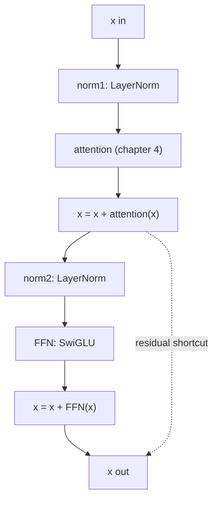

# Chapter 5 — The Transformer Block

> *A block is one thinking unit. It listens (attention), thinks (feed-forward), and keeps a photocopy of the original note.*

---

## The 5-year-old analogy

Imagine you are taking notes while someone talks.

1. You first **normalize** your notes so all the numbers are on the same scale.
2. You **listen again** to what was said and add anything important to your notes (attention + residual).
3. You normalize again.
4. You **think harder** about the note using a small internal checklist (feed-forward + residual).

The photocopy is the **residual connection**: `x = x + something`. It lets information skip the hard parts, so gradients can flow backwards without getting lost.



---

## The code

`hermitlm/training/model.py:54-66`:

```python
54: class Block(nn.Module):
55:     def __init__(self, config):
56:         super().__init__()
57:         self.norm1 = nn.LayerNorm(config.d_model)
58:         self.attn = Attention(config)
59:
60:         self.norm2 = nn.LayerNorm(config.d_model)
61:         self.ffn = FFN(config)
62:
63:     def forward(self, x, mask=None):
64:         x = x + self.attn(self.norm1(x), mask)
65:         x = x + self.ffn(self.norm2(x))
66:         return x
```

Two details matter:

- Normalization happens **before** attention and before the FFN. This is **pre-norm**.
- The residual `x + ...` wraps each sublayer, so each one only has to learn a correction.

Post-norm (normalize after adding) was common in early Transformers. Pre-norm is used here because it trains more stably in deep stacks.

---

## LayerNorm

A LayerNorm over `d_model = 320` computes, for each token independently:

$$
\begin{aligned}
\mu = \frac{1}{d}\sum_i x_i, \qquad \sigma^2 = \frac{1}{d}\sum_i (x_i-\mu)^2 \\
\hat{x}_i = \frac{x_i-\mu}{\sqrt{\sigma^2+\varepsilon}}, \qquad y_i = \gamma_i \hat{x}_i + \beta_i
\end{aligned}
$$

PyTorch uses `ε = 1e-5` by default. `γ` (weight) and `β` (bias) are learned, one per dimension, so each LayerNorm has `2 × 320 = 640` parameters.

### Worked example with three numbers

Take the toy vector `[1.0, 2.0, 6.0]` (used here with d=3 for readable arithmetic):

$$
\begin{aligned}
\mu = (1 + 2 + 6)/3 = 3 \\
deviations      = [-2, -1, 3] \\
\sigma^2 = (4 + 1 + 9)/3 = 14/3 = 4.6667 \\
\sigma = 2.1602 \\
\hat{x} = [-2/2.1602, -1/2.1602, 3/2.1602] = [-0.9258, -0.4629, 1.3887]
\end{aligned}
$$

With `γ = 1` and `β = 0` (initial values), the output is `x̂`. The mean is now 0 and the variance is 1.

With the real 320-dimensional vectors from chapter 3, the same operation runs 320 elements at a time for every token.

---

## The SwiGLU feed-forward network

`model.py:40-52`:

```python
40: class FFN(nn.Module):
41:     def __init__(self, config):
42:         super().__init__()
43:         hidden = config.ffn_hidden
44:
45:         self.w1 = nn.Linear(config.d_model, hidden, bias=False)
46:         self.w2 = nn.Linear(config.d_model, hidden, bias=False)
47:         self.w3 = nn.Linear(hidden, config.d_model, bias=False)
48:
49:         self.dropout = nn.Dropout(config.dropout)
50:
51:     def forward(self, x):
52:         return self.dropout(self.w3(F.silu(self.w2(x)) * self.w1(x)))
```

The formula is:

$$
\begin{aligned}
\operatorname{FFN}(x) = w_3\big(\operatorname{silu}(w_2 x) \odot w_1 x\big)
\end{aligned}
$$

| Symbol | Shape | Role |
|---|---|---|
| `w1(x)` | `(B, T, 800)` | the **gate** input |
| `w2(x)` | `(B, T, 800)` | the value input |
| `silu(z)` | `(B, T, 800)` | `z / (1 + exp(−z))` |
| `⊙` | element-wise product | decide what passes |
| `w3(·)` | `(B, T, 320)` | project back to `d_model` |

SwiGLU uses **three** matrices where a classic ReLU FFN uses two. That costs 50% more parameters in the FFN but often learns better gating.

### SiLU worked example

For `z = 0.8`:

$$
\begin{aligned}
silu(0.8) = 0.8 / (1 + e^{-0.8}) = 0.8 / (1 + 0.4493) = 0.8 / 1.4493 = 0.5521
\end{aligned}
$$

For `z = −0.5`:

$$
\begin{aligned}
silu(-0.5) = -0.5 / (1 + e^{0.5}) = -0.5 / (1 + 1.6487) = -0.5 / 2.6487 = -0.1888
\end{aligned}
$$

SiLU is smooth and lets small negative values through, unlike ReLU which clamps them to zero.

### A two-dimensional toy FFN

Let `w1(x) = [0.5, −1.0]`, `w2(x) = [0.8, 0.4]`:

$$
\begin{aligned}
silu(w2(x)) = [silu(0.8), silu(0.4)] = [0.5521, 0.2395] \\
gate product = [0.5 \times 0.5521, -1.0 \times 0.2395] = [0.2761, -0.2395]
\end{aligned}
$$

The second component is suppressed by the gate. With real matrices the same thing happens across 800 channels.

---

## Parameter count of one block

| Part | Calculation | Parameters |
|---|---|---:|
| `norm1` | 2 × 320 | 640 |
| Attention `qkv` | 320 × 960 + 960 | 308,160 |
| Attention `out` | 320 × 320 + 320 | 102,720 |
| `norm2` | 2 × 320 | 640 |
| FFN `w1` | 320 × 800 | 256,000 |
| FFN `w2` | 320 × 800 | 256,000 |
| FFN `w3` | 800 × 320 | 256,000 |
| **One block** | sum | **1,180,160** |
| **Six blocks** | 6 × 1,180,160 | **7,080,960** |

The FFN dominates: 4,608,000 of the 7,080,960 block parameters, or 65%.

---

## Dropout in this block

Dropout appears twice in a block: on the attention weights (`model.py:17,33`) and on the FFN output (`model.py:49`). The embedding dropout from chapter 3 makes a third. Each uses `p = 0.1` during SFT.

All dropout layers are inactive when `model.eval()` is called in `hermitlm/runtime/inference.py:32`.

---

## Math and calculations

### Residual gradient flow

If `y = x + f(x)`, then:

$$
\begin{aligned}
\partial y/\partial x = I + \partial f/\partial x
\end{aligned}
$$

The identity matrix `I` gives gradients a direct path backwards, even when `∂f/∂x` is small. This is why residual networks can be much deeper than plain stacks.

### Pre-norm effect

Pre-norm computes `x + f(LayerNorm(x))`. The sublayer always sees standardized inputs, so its gradient scale does not depend on the magnitude of earlier activations. Post-norm computes `LayerNorm(x + f(x))`, which can divide large accumulated residuals by a large standard deviation.

### Multiply-adds in the FFN

For one token, one block:

$$
\begin{aligned}
w_1: 320 \times 800 = 256{,}000 \\
w_2: 320 \times 800 = 256{,}000 \\
w_3: 800 \times 320 = 256{,}000 \\
\text{total} = 768{,}000\text{ multiply-adds per token per block}
\end{aligned}
$$

For a full sequence of 512 tokens and 6 blocks:

$$
\begin{aligned}
768{,}000 \times 512 \times 6 = 2{,}359{,}296{,}000\text{ multiply-adds}
\end{aligned}
$$

Counting the multiply-and-add as two floating-point operations gives 4,718,592,000 FLOPs, matching chapter 4's comparison.

### LayerNorm parameters

$$
\begin{aligned}
\text{per LayerNorm} = 320 + 320 = 640 \\
\text{12 in blocks} = 7{,}680 \\
\text{final} = 640 \\
\text{total} = 8{,}320
\end{aligned}
$$

---

## Code you should remember

| File and lines | What it does |
|---|---|
| `hermitlm/training/model.py:54-66` | Pre-norm block with two residuals |
| `hermitlm/training/model.py:40-52` | Three-matrix SwiGLU FFN |
| `hermitlm/training/model.py:45-47` | Bias-free linear layers |
| `hermitlm/config.py:13` | `ffn_hidden = 800` |

---

**Next:** [Chapter 6 — The complete model](06_gpt_model.md)
