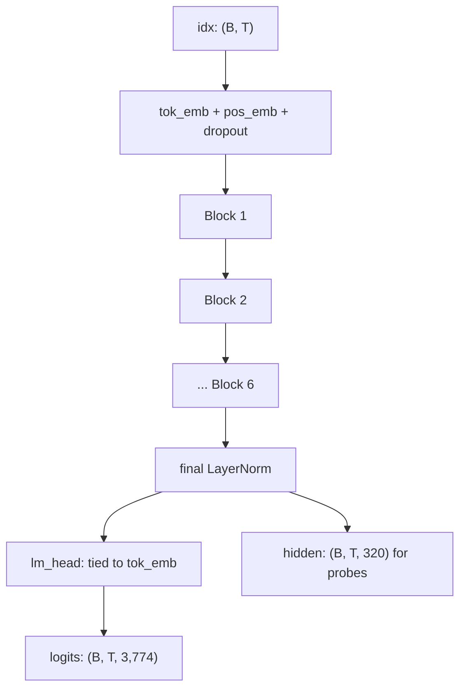

# Chapter 6 — The Complete Model

> *Six blocks, two embedding tables, one shared output head. Add them up and you get 8,453,120 numbers.*

---

## The 5-year-old analogy

Think of the model as a sandwich:

1. **Bottom bread**: turn IDs into vectors with meaning and position.
2. **Filling**: six identical blocks of listen-and-think.
3. **Top bread**: one final normalization, then a lookup that produces 3,774 scores.

The score at position `t` is a guess for token `t+1`. The guess is a list of 3,774 numbers, not a word. Chapter 8 turns that list into a word.



---

## The constructor

`hermitlm/training/model.py:68-99`:

```python
68: class HermitLM(nn.Module):
69:     def __init__(self, config):
70:         super().__init__()
71:         self.config = config
72:
73:         self.tok_emb = nn.Embedding(config.vocab_size, config.d_model)
74:         self.pos_emb = nn.Embedding(config.max_seq_len, config.d_model)
75:
76:         self.drop = nn.Dropout(config.dropout)
77:
78:         self.blocks = nn.ModuleList([
79:             Block(config) for _ in range(config.n_layers)
80:         ])
81:
82:         self.norm = nn.LayerNorm(config.d_model)
83:
84:         self.lm_head = nn.Linear(config.d_model, config.vocab_size, bias=False)
85:
86:         # weight tying
87:         self.lm_head.weight = self.tok_emb.weight
88:
89:         self.apply(self._init_weights)
```

Every block is the same class from chapter 5. `n_layers = 6` means six copies with separate weights.

---

## The forward pass

`model.py:110-139`:

```python
110:    def forward(self, idx, targets=None, return_hidden=False):
111:        _B, T = idx.shape
112:
113:        pos = torch.arange(0, T, device=idx.device)
114:
115:        x = self.tok_emb(idx) + self.pos_emb(pos)
116:        x = self.drop(x)
117:
118:        # causal mask
119:        mask = torch.tril(torch.ones(T, T, device=idx.device)).bool()
120:        mask = mask.unsqueeze(0).unsqueeze(0)
121:
122:        for block in self.blocks:
123:            x = block(x, mask)
124:
125:        x = self.norm(x)
126:        logits = self.lm_head(x)
127:
128:        loss = None
129:        if targets is not None:
130:            loss = F.cross_entropy(
131:                logits.view(-1, self.config.vocab_size),
132:                targets.view(-1),
133:                ignore_index=self.config.pad_id
134:            )
```

For the 10-token prompt from chapter 2 with batch size 1:

| Step | Shape |
|---|---|
| `idx` | `(1, 10)` |
| after embeddings | `(1, 10, 320)` |
| after 6 blocks | `(1, 10, 320)` |
| after final norm | `(1, 10, 320)` |
| `logits` | `(1, 10, 3,774)` |

At position 9 (the last token, `\n` after `assistant`), the 3,774 logits are the model's guess for the first token of the reply.

### A note about the internal loss

Lines 128-134 compute cross-entropy with `ignore_index=pad_id`, but `hermitlm/training/train.py:204` calls `model(x)` **without targets**, so `targets` is `None` and this loss is never used during SFT. The real loss is the masked mean in `train.py:51-61` (chapter 7). The internal path still helps tests and quick experiments.

---

## The parameter count, term by term

Notation: `V = 3,774`, `D = 320`, `L = 6`, `H = 8`, `F = 800`, `P = 512`.

| Component | Calculation | Parameters |
|---|---|---:|
| Token embedding | `V × D = 3,774 × 320` | 1,207,680 |
| Position embedding | `P × D = 512 × 320` | 163,840 |
| 6 × attention QKV | `6 × (D × 3D + 3D) = 6 × 308,160` | 1,848,960 |
| 6 × attention output | `6 × (D × D + D) = 6 × 102,720` | 616,320 |
| 6 × SwiGLU FFN | `6 × (3 × D × F) = 6 × 768,000` | 4,608,000 |
| 12 block LayerNorms | `12 × (2 × D) = 12 × 640` | 7,680 |
| Final LayerNorm | `2 × D = 640` | 640 |
| LM head | tied to token embedding | 0 |
| **Total unique** | | **8,453,120** |
| Duplicate tied head in `state_dict` | `V × D` | +1,207,680 |
| **Raw checkpoint sum** | | **9,660,800** |

This matches `docs/02-architecture.md:22-37` exactly. If you want to check it yourself:

```python
from hermitlm.config import HermitConfig
from hermitlm.training.model import HermitLM
m = HermitLM(HermitConfig())
print(m.param_count())                       # with default vocab 2,833
print(sum(p.numel() for p in m.parameters()))
```

Set `vocab_size = 3774` first to reproduce the shipped count.

### Percentage breakdown

| Group | Parameters | Share |
|---|---:|---:|
| FFN | 4,608,000 | 54.5% |
| Attention | 2,465,280 | 29.2% |
| Token embedding | 1,207,680 | 14.3% |
| Position embedding | 163,840 | 1.9% |
| LayerNorms | 8,320 | 0.1% |

The FFN holds more than half the model. That is why `ffn_hidden = 800` is the largest single lever on model size.

---

## The ONNX wrapper

`model.py:216-233` exports both outputs in one pass:

```python
216: class ChatWithHidden(nn.Module):
217:     """ONNX export wrapper. Returns chat logits plus the last-token hidden state.
218:
219:     The hidden state feeds the probe decision model, so one shared artifact
220:     serves both chat generation and single-pass intent classification.
221:     """
...
228:     def forward(self, idx):
229:         if self.layer is None:
230:             _logits, _loss, hidden = self.model(idx, return_hidden=True)
231:             return _logits, hidden[:, -1, :]
232:         logits, hidden = self.model.forward_with_hidden_layers(idx)
233:         return logits, hidden[:, -1, self.layer, :]
```

`return_hidden=True` is enabled by the `forward` branch at `model.py:136-137`:

```python
136:        if return_hidden:
137:            return logits, loss, x
```

Here `x` is the output of the final LayerNorm, shape `(B, T, 320)`. Taking `[:, -1, :]` gives one 320-vector for the whole prompt. Chapter 10 fits linear intent heads on exactly that vector.

The shipped probe has no `selection` key, so `layer = None` in `scripts/export_onnx.py:24-31` and the browser gets the **last layer** hidden state.

---

## Generation method inside the model

`model.py:170-206` implements `generate()`. It is a simple loop over `max_new_tokens`; each step runs `forward`, takes the last position's logits, optionally filters by temperature and top-k, samples one ID, and appends it. Chapter 8 walks through it.

The method also restores the caller's training mode in a `finally` block (`model.py:203-204`), so calling `generate()` never leaves the model in eval mode.

---

## Math and calculations

### General parameter formula

$$ \Large \text{embedding parameters} = V D + P_{\max} D $$

$$ \Large \text{attention per block} = 4D^2 + 4D $$

$$ \Large \text{FFN per block} = 3 D F $$

$$ \Large \text{LayerNorm per block} = 4D $$

$$ \Large \text{total} = V D + P_{\max} D + L\left(4D^2 + 8D + 3 D F\right) + 2D $$

Here `8D` is the 4D of attention biases plus the 4D of LayerNorm weights and biases in each block.

Substituting `V=3774, D=320, P_max=512, L=6, F=800`:

$$ \Large \text{embedding} = 1{,}207{,}680 + 163{,}840 = 1{,}371{,}520 $$

$$ \Large \text{attention} = 2{,}465{,}280 $$

$$ \Large \text{FFN} = 4{,}608{,}000 $$

$$ \Large \text{LayerNorm} = 8{,}320 $$

$$ \Large \text{total} = 8{,}453{,}120 $$

### With a different FFN size

If `ffn_hidden` changed from 800 to 1,024:

$$ \Large \text{new FFN} = 6 \times 3 \times 320 \times 1{,}024 = 5{,}898{,}240 $$

$$ \Large \text{delta} = 5{,}898{,}240 - 4{,}608{,}000 = +1{,}290{,}240 $$

$$ \Large \text{new total} = 9{,}743{,}360 $$

### Size of one forward pass output

$$ \Large \text{logit values} = 1 \times 512 \times 3{,}774 = 1{,}932{,}288 $$

$$ \Large \text{logit bytes} = 1{,}932{,}288 \times 4 = 7{,}729{,}152 \approx 7.7 \text{ MB} $$

This is why the browser takes only the last position's 3,774 logits for sampling (`web/model.js:218-221`).

---

## Code you should remember

| File and lines | What it does |
|---|---|
| `hermitlm/training/model.py:68-99` | Full model constructor |
| `hermitlm/training/model.py:110-139` | Forward pass and optional internal loss |
| `hermitlm/training/model.py:141-168` | Per-layer hidden states for probe fitting |
| `hermitlm/training/model.py:208-213` | Unique parameter count and summary |
| `hermitlm/training/model.py:216-233` | ONNX wrapper returning logits + hidden state |
| `hermitlm/config.py:4-19` | All model hyperparameters |

---

**Next:** [Chapter 7 — Data and training](07_training.md)
