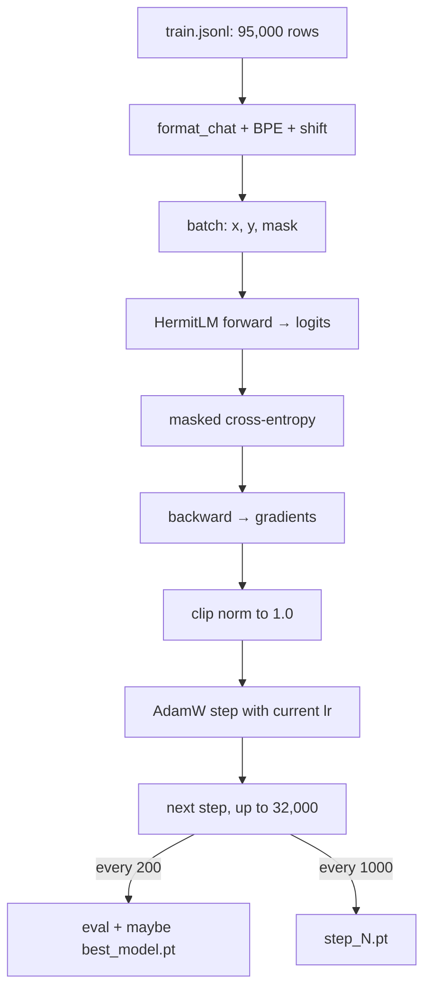

# Chapter 7 — Data and Training

> *Training is 32,000 rounds of: guess the next word, measure the mistake, nudge every number a little.*

---

## The 5-year-old analogy

Give the crab a sentence with the last word covered. It guesses. You tell it how wrong it was. It adjusts its 8.45 million knobs by a tiny amount. Repeat 32,000 times, with the "how wrong" signal getting smaller and smaller over time.

Two rules make this work:

1. **Masked loss**: ignore the padding and score only real words.
2. **Learning-rate schedule**: start with tiny steps (warmup), grow to the peak, then slowly shrink (cosine decay).



---

## Where the data comes from

`hermitlm/training/generate_data.py` is 1,105 lines of templates. `generate_dataset()` (`generate_data.py:1040-1101`):

- builds rows from 21 fine types such as `greeting`, `food`, `water`, `temp_cold`, `breathing`, `confused`
- adds 4,200 natural paraphrases via `build_natural_samples(per_type=200)` (`generate_data.py:994-1004`)
- adds persona-prefixed variants with `add_persona_variants()` at probability 0.25 (`generate_data.py:1031-1037`)
- shuffles and splits 95% / 5%
- writes `train.jsonl`, `eval.jsonl`, `train_openai.jsonl`, `eval_openai.jsonl`

`hermitlm/training/natural_data.py:1-7` says why the natural data exists: the template generator reached about 1.0 on its own eval but only **14/20** on natural paraphrases. Hand-written phrasings and small perturbations (prefix, suffix, typo) close that gap.

### The shipped data on disk

| File | Rows |
|---|---:|
| `data/train.jsonl` | 95,000 |
| `data/eval.jsonl` | 5,000 |
| `data/train_openai.jsonl` | 95,000 |
| `data/eval_openai.jsonl` | 5,000 |

Average formatted length is about 20 words and 169 characters per training row, far below `max_seq_len = 512`.

> ⚠️ The on-disk JSONL files predate the natural-sample and persona-variant code. A fresh run of `generate_dataset()` would produce 104,200 rows, not 95,000. `README.md:149-151` also notes that PPO and DPO were not rerun on the newer corpus.

### Training category counts

The 21 types are not equally frequent in the shipped data. Examples:

| Type | Train rows |
|---|---:|
| `greeting` | 8,910 |
| `misc` | 8,907 |
| `state` | 8,869 |
| `light` | 6,018 |
| `food` | 6,011 |
| `glass` | 3,029 |
| `sound` | 2,854 |

That roughly matches an older 3/2/1 weighting scheme: heavy classes get about 9.4%, medium 6.3%, light 3.1%.

---

## Batching and the shift

`hermitlm/training/dataset.py` produces three tensors per batch (chapter 2):

| Tensor | Shape | Meaning |
|---|---|---|
| `x` | `(B, T)` | input token IDs |
| `y` | `(B, T)` | next-token targets |
| `attention_mask` | `(B, T)` | 1 for real tokens |

`train.py:133-147` builds two loaders:

```python
133:    train_loader, train_dataset = get_dataloader(
134:        os.path.join(tc.data_dir, "train.jsonl"),
135:        tokenizer_path, mc.max_seq_len, tc.batch_size, shuffle=True,
136:    )
...
141:    eval_loader, eval_dataset = get_dataloader(
142:        os.path.join(tc.data_dir, "eval.jsonl"),
143:        tokenizer_path, mc.max_seq_len, tc.batch_size, shuffle=False,
144:    )
```

---

## The loss: masked cross-entropy

`train.py:51-61`:

```python
51: def compute_loss(logits, targets, mask):
52:     vocab_size = logits.size(-1)
53:
54:     loss = torch.nn.functional.cross_entropy(
55:         logits.view(-1, vocab_size),
56:         targets.view(-1),
57:         reduction="none"
58:     )
59:
60:     loss = (loss * mask.view(-1)).sum() / mask.sum()
61:     return loss
```

Let `m_{ij}` be the attention mask and `q_{ij,v}` the softmax probability the model assigns to vocabulary item `v` at position `(i,j)`:

$$ \Large \text{CE}_{ij} = -\log q_{ij,y_{ij}} $$

$$ \Large \text{L}_{\text{SFT}} = \frac{\sum_{ij} m_{ij}\,\text{CE}_{ij}}{\sum_{ij} m_{ij}} $$

### Worked example

Suppose a batch has two rows with 4 and 2 real tokens:

$$ \Large \text{mask row 1} = [1, 1, 1, 1] $$

$$ \Large \text{mask row 2} = [1, 1, 0, 0] $$

There are 6 ones. If the six per-token cross-entropies are `[0.5, 0.8, 0.3, 0.6, 0.9, 0.4]`:

$$ \Large \text{weighted loss sum} = 0.5 + 0.8 + 0.3 + 0.6 + 0.9 + 0.4 = 3.5 $$

$$ \Large \text{active token count} = 6 $$

$$ \Large \text{loss} = \frac{3.5}{6} = 0.583333 $$

Padding positions contribute 0 to both sums, so they cannot lower or raise the loss.

### Relationship to perplexity

Perplexity is `exp(loss)`. The shipped best checkpoint has eval loss `0.6541` (`checkpoints/best_model.pt`):

$$ \Large \text{perplexity} = \exp(0.6541) = 1.9234 $$

`eval_out/report.json` records a perplexity proxy of 1.929, computed as `exp(mean loss)` over at most 50 batches (`scripts/eval.py:38-46`).

---

## The learning-rate schedule

`train.py:42-49`:

```python
42: def get_lr(step, config):
43:     if step < config.warmup_steps:
44:         return config.learning_rate * step / config.warmup_steps
45:
46:     progress = (step - config.warmup_steps) / max(1, config.max_steps - config.warmup_steps)
47:     coeff = 0.5 * (1 + math.cos(math.pi * progress))
48:
49:     return config.min_lr + (config.learning_rate - config.min_lr) * coeff
```

With `η = 2e-4`, `η_min = 2e-5`, `W = 800`, `M = 32,000`:

$$ \Large \text{when } s < W: \quad \eta_s = \eta \frac{s}{W} $$

$$ \Large \text{when } s \geq W: \quad p = \frac{s-W}{M-W} $$

$$ \Large c = \frac{1}{2}(1 + \cos(\pi p)) $$

$$ \Large \eta_s = \eta_{\min} + (\eta-\eta_{\min})c $$

| Step | Phase | Learning rate |
|---:|---|---:|
| 0 | warmup | 0.000000e+0 |
| 100 | warmup | 2.50e−5 |
| 400 | warmup | 1.00e−4 |
| 799 | warmup | 1.9975e−4 |
| 800 | peak | 2.0000e−4 |
| 2,000 | cosine | 1.9934e−4 |
| 8,000 | cosine | 1.7737e−4 |
| 16,000 | cosine | 1.1362e−4 |
| 24,200 | cosine | 4.6360e−5 |
| 30,000 | cosine | 2.1819e−5 |
| 31,999 | cosine | 2.0000e−5 |

Warmup is `800 / 32,000 = 2.5%` of training. The final rate is not exactly `min_lr` because the last call happens at step 31,999.

`train.py:186-188` injects the computed value into the optimizer every step:

```python
186:            lr = get_lr(step, tc)
187:            for pg in optimizer.param_groups:
188:                pg["lr"] = lr
```

---

## AdamW and gradient clipping

`train.py:151-156`:

```python
151:    optimizer = torch.optim.AdamW(
152:        model.parameters(),
153:        lr=tc.learning_rate,
154:        weight_decay=tc.weight_decay,
155:        betas=(0.9, 0.95),
156:    )
```

AdamW keeps two running averages per parameter:

$$ \Large m_t = \beta_1 m_{t-1} + (1-\beta_1)g_t $$

$$ \Large \beta_1 = 0.9 $$

$$ \Large v_t = \beta_2 v_{t-1} + (1-\beta_2)g_t^2 $$

$$ \Large \beta_2 = 0.95 $$

$$ \Large \hat{m}_t = \frac{m_t}{1-\beta_1^t}, \quad \hat{v}_t = \frac{v_t}{1-\beta_2^t} $$

$$ \Large \theta_t = \theta_{t-1} - \eta\frac{\hat{m}_t}{\sqrt{\hat{v}_t}+\varepsilon} - \eta\lambda\theta_{t-1} $$

where `ε = 1e-8` and weight decay `λ = 0.1`.

Before the optimizer step, `train.py:207-209` clips the gradient norm:

```python
207:                loss.backward()
208:                torch.nn.utils.clip_grad_norm_(model.parameters(), tc.grad_clip)
209:                optimizer.step()
```

If the global L2 norm of all gradients exceeds `1.0`, every gradient is multiplied by `1.0 / norm`. This prevents one bad batch from making a giant update.

Mixed precision is enabled only on CUDA (`train.py:158-159`). XPU and CPU use the plain path above.

---

## The training loop

`train.py:166-258` runs the show:

| Lines | Event |
|---|---|
| 167 | `step = 0`, `best_eval = inf` |
| 175–189 | fetch batch, move to device, set LR |
| 190–211 | forward, loss, backward, clip, step, zero grad |
| 216–219 | print mean of last 100 losses every 100 steps |
| 222–237 | evaluate every 200 steps, save `best_model.pt` if improved |
| 240–245 | save `step_N.pt` every 1,000 steps |
| 249–255 | save `final_model.pt` with the full loss list |

The shipped best checkpoint metadata:

$$ \Large \text{step} = 24{,}200 $$

$$ \Large \text{eval loss} = 0.6540815 $$

$$ \Large \text{perplexity} = 1.9234 $$

`final_model.pt` comes from an older 30,000-step run with vocabulary 2,831 and a loss list of length 30,000. Its first losses are around 8.07 and its last around 0.65.

> `train.py` has no resume logic. It only writes checkpoints. The "resume" in `scripts/retrain_resume.ps1` is pipeline-level bookkeeping that skips already-finished shell stages.

---

## Math and calculations

### Batches and passes

$$ \Large \text{batches per epoch} = \frac{95{,}000}{32} = 2{,}968.75 $$

$$ \Large \text{maximum steps} = 32{,}000 $$

$$ \Large \text{sequences seen} = 32{,}000 \times 32 = 1{,}024{,}000 $$

$$ \Large \text{passes over the data} = \frac{1{,}024{,}000}{95{,}000} = 10.78 $$

### Token positions

$$ \Large \text{token positions per step} = 32 \times 512 = 16{,}384 $$

$$ \Large \text{token positions upper bound} = 16{,}384 \times 32{,}000 = 524{,}288{,}000 $$

Real rows are about 20 words, so actual processed tokens are much fewer. `max_seq_len=512` is a ceiling, not the typical length.

### Evaluation and saving frequency

$$ \Large \text{eval calls} = 159 $$

$$ \Large \text{save points} = 31 $$

$$ \Large \text{last saved step} = 31{,}000 $$

### Warmup fraction and peak ratio

$$ \Large \text{warmup fraction} = \frac{800}{32{,}000} = 2.5\% $$

$$ \Large \text{peak to floor ratio} = \frac{2 \times 10^{-4}}{2 \times 10^{-5}} = 10 $$

### Cosine coefficient at step 16,000

$$ \Large \text{progress at step 16,000} = p = 0.487179 $$

$$ \Large c = \frac{1}{2}\left(1+\cos(\pi p)\right) = 0.52014 $$

$$ \Large \text{learning rate at step 16,000} = 1.1362 \times 10^{-4} $$

---

## Code you should remember

| File and lines | What it does |
|---|---|
| `hermitlm/training/train.py:42-49` | Warmup + cosine learning rate |
| `hermitlm/training/train.py:51-61` | Masked cross-entropy |
| `hermitlm/training/train.py:92-113` | Evaluation over at most 50 batches |
| `hermitlm/training/train.py:151-159` | AdamW and CUDA-only AMP |
| `hermitlm/training/train.py:190-211` | Forward, backward, clip, step |
| `hermitlm/training/train.py:221-255` | Evaluation and checkpoint writes |
| `hermitlm/config.py:22-43` | All training hyperparameters |

---

**Next:** [Chapter 8 — Generation](08_generation.md)
