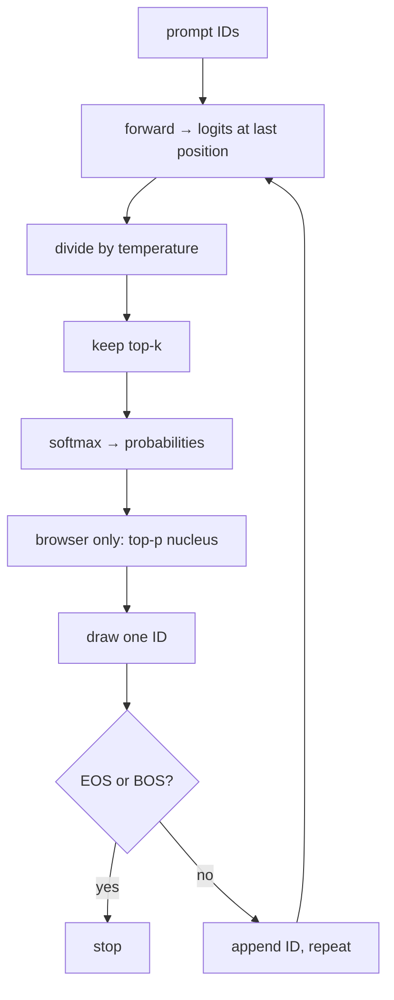

# Chapter 8 — Generation: Turning Scores Into Words

> *The model does not choose a word. It gives every word a score, and a sampler rolls a weighted die.*

---

## The 5-year-old analogy

After reading your prompt, the crab holds a raffle ticket for every word it knows. Popular words get more tickets. It draws one ticket, writes the word, then holds a new raffle using the longer text.

Three knobs change the raffle:

| Knob | Effect |
|---|---|
| **Temperature** | Low: favorite wins almost always. High: long shots get a chance. |
| **top-k** | Only the k highest-scoring words get tickets. |
| **top-p** | Keep the smallest set of words whose total chance reaches p. |



---

## The Python sampling loop

`hermitlm/training/model.py:170-206`:

```python
176:            for _ in range(max_new_tokens):
177:                idx_cond = idx[:, -self.config.max_seq_len:]
178:
179:                logits, _ = self(idx_cond)
180:
181:                # Sampling is tiny (one vocab vector per step). Doing it on
182:                # CPU avoids flaky Level Zero errors on Intel XPU and keeps
183:                # generation identical across backends.
184:                sample_logits = logits[:, -1, :].float().cpu() / temperature
185:
186:                if top_k > 0:
187:                    v, _ = torch.topk(sample_logits, min(top_k, sample_logits.size(-1)))
188:                    sample_logits = torch.where(
189:                        sample_logits < v[:, [-1]],
190:                        torch.full_like(sample_logits, float("-inf")),
191:                        sample_logits,
192:                    )
193:
194:                probs = F.softmax(sample_logits, dim=-1)
195:                next_cpu = torch.multinomial(probs, num_samples=1)
196:                next_id = next_cpu.to(idx.device)
197:
198:                idx = torch.cat([idx, next_id], dim=1)
199:
200:                if next_cpu.numel() == 1 and int(next_cpu.item()) == self.config.eos_id:
201:                    break
```

Steps:

1. Truncate context to the last 512 IDs so positions stay in distribution.
2. Run one forward pass and take only the last position's 3,774 logits.
3. Divide by temperature and move to CPU float32.
4. If `top_k > 0`, set every logit below the k-th largest to `−∞`.
5. Softmax to a probability distribution.
6. Draw one ID with `torch.multinomial`.
7. Stop if the ID is EOS.

### Stop markers in the runtime

`hermitlm/runtime/inference.py:54-57` also stops at BOS, because a well-behaved model ends with `<|im_end|>` but a stray new turn would start with `<|im_start|>`:

```python
54:        for i, token_id in enumerate(generated_ids):
55:            if token_id in (self.config.eos_id, self.config.bos_id):
56:                generated_ids = generated_ids[:i]
57:                break
```

---

## Worked example: temperature and top-k

Take five logits `[3, 2, 1, 0, −1]` with `temperature = 0.8` and `top_k = 2`.

### Step 1 — divide by temperature

```
[3/0.8, 2/0.8, 1/0.8, 0/0.8, −1/0.8] = [3.75, 2.50, 1.25, 0, −1.25]
```

### Step 2 — top-k threshold

The second largest value is `v = 2.5`. Everything below becomes `−∞`:

```
[3.75, 2.50, −∞, −∞, −∞]
```

### Step 3 — softmax

```
e^3.75 = 42.5211
e^2.50 = 12.1825
sum    = 54.7036

p = [42.5211/54.7036, 12.1825/54.7036, 0, 0, 0]
  = [0.7773,          0.2227,          0, 0, 0]
```

The first token wins about 78% of the time and the second about 22%. No other token can ever be drawn.

### Effect of temperature

Using the same raw logits without top-k:

| T | Probabilities for the five logits |
|---|---|
| 0.5 | `[0.8647, 0.1170, 0.0158, 0.0021, 0.0003]` |
| 0.8 | `[0.7149, 0.2048, 0.0587, 0.0168, 0.0048]` |
| 1.0 | `[0.6364, 0.2341, 0.0861, 0.0317, 0.0117]` |
| 2.0 | `[0.4287, 0.2600, 0.1577, 0.0956, 0.0580]` |

Lower temperature sharpens the die. Higher temperature flattens it.

---

## Top-p in the browser

The Python path has temperature and top-k only. The browser adds nucleus sampling in `web/model.js:25-98`, with `topP = 0.95` as a default (`web/model.js:200`).

The rule (`model.js:69-88`):

1. Sort candidate IDs by probability.
2. Accumulate until `cum >= topP`.
3. Keep the smallest set that reached the threshold.
4. Renormalize those probabilities to sum to 1.

### Worked example

Probabilities `[0.40, 0.30, 0.20, 0.10]`:

| topP | Kept tokens | Renormalized |
|---|---|---|
| 0.95 | all 4 (cum 1.00) | `[0.40, 0.30, 0.20, 0.10]` |
| 0.80 | first 3 (cum 0.90) | `[0.4444, 0.3333, 0.2222]` |
| 0.60 | first 2 (cum 0.70) | `[0.5714, 0.4286]` |

For `topP = 0.80`, the kept mass is `0.40 + 0.30 + 0.20 = 0.90`, so each kept probability is divided by 0.9: `0.40/0.9 = 0.4444`, and so on.

The browser draws with inverse CDF (`model.js:92-96`): pick `r = Math.random() × sum`, subtract probabilities in order until `r <= 0`.

---

## Defaults in each path

| Path | max tokens | temperature | top-k | top-p | Source |
|---|---:|---:|---:|---:|---|
| `HermitLM.generate` | 64 | 0.8 | 50 | — | `model.py:171` |
| `HermitInference.chat` | 64 | 0.8 | 40 | — | `runtime/inference.py:36` |
| API and browser defaults | 80 | 0.6 | 20 | 0.95 (browser only) | `settings.py:15-17`, `web/model.js:200` |
| Evaluation generations | 48 | 0.6 | 20 | — | `scripts/eval.py:66` |
| PPO rollouts | 48 | 1.0 | 50 | — | `config.py:57-59` |
| DPO candidate pairs | 48 | 0.8 | 40 | — | `dpo.py:17,26` |

The API enforces bounds: temperature `[0.1, 2.0]`, top_k `[0, 200]`, max_tokens `[1, 256]` (`api.py:53-55`).

---

## Best-of-N reranking

`runtime/inference.py:67-79` generates several replies and keeps the one with the highest persona reward (chapter 11):

```python
72:        candidates = self.chat_candidates(user_input, n, temperature, top_k, max_tokens)
73:        if len(candidates) == 1:
74:            return candidates[0], [0.0]
75:        from hermitlm.training.reward import score_response
76:
77:        scores = [score_response(text) for text in candidates]
78:        best = max(range(len(candidates)), key=lambda i: scores[i])
79:        return candidates[best], scores
```

`BEST_OF = 3` by default (`settings.py:23`). With three candidates scoring `[0.46, 0.18, 0.61]`, the API returns candidate 3 and logs all three scores. Setting `HERMIT_BEST_OF=1` skips the reranker and returns `[0.0]`.

---

## Streaming

The browser streams real token IDs: `web/model.js:198-230` is an async generator that yields each sampled ID, and `web/index.html:716-739` decodes and appends it live.

The API's `/chat/stream` is different. It streams **whitespace-split words** after the full reply is ready (`api.py:225-229`):

```python
225:            # Naive word streaming (true token streaming needs generate()
226:            # to yield; the local web UI already streams ONNX tokens).
227:            for w in response.split():
228:                yield f"data: {w} \n\n"
```

Every SSE line gets its own `data:` prefix because tool results can be multi-line (`api.py:219-223`). The stream ends with `data: [DONE]`.

---

## Math and calculations

### Temperature scaling

```
z_v = logit_v / T
```

- `T < 1` increases the gaps between logits.
- `T = 1` leaves them unchanged.
- `T > 1` shrinks the gaps.

`T = 0` is invalid; the API clamps the minimum to 0.1.

### Top-k threshold

```
v_k   = k-th largest z
z'_v  = z_v    if z_v >= v_k
        −∞      otherwise
```

### Softmax after masking

```
p_v = exp(z'_v − max(z')) / Σ_u exp(z'_u − max(z'))
```

With `−∞` entries the exponential is exactly 0.

### Nucleus cutoff

```
cutoff = min { k : Σ_{j=1..k} p_(j) >= topP }
p'_i   = p_i / Σ_{j=1..cutoff} p_(j)   for kept i
```

### Cost of generation

```
forward passes = max_new_tokens
at 80 tokens  = 80 passes over the growing context
context at step t = prompt_len + t tokens, capped at 512
```

The browser displays tokens per second from the count and elapsed time (`web/index.html:716-739`).

---

## Code you should remember

| File and lines | What it does |
|---|---|
| `hermitlm/training/model.py:170-206` | Python generation loop |
| `hermitlm/runtime/inference.py:36-61` | Prompt formatting, stop tokens |
| `hermitlm/runtime/inference.py:67-79` | Best-of-N reranking |
| `web/model.js:25-98` | Temperature, top-k, top-p sampler |
| `web/model.js:198-230` | Browser token stream |
| `hermitlm/runtime/api.py:207-231` | SSE word stream |
| `hermitlm/settings.py:15-25` | Runtime defaults and thresholds |

---

**Next:** [Chapter 9 — Tools and routing](09_tools.md)
