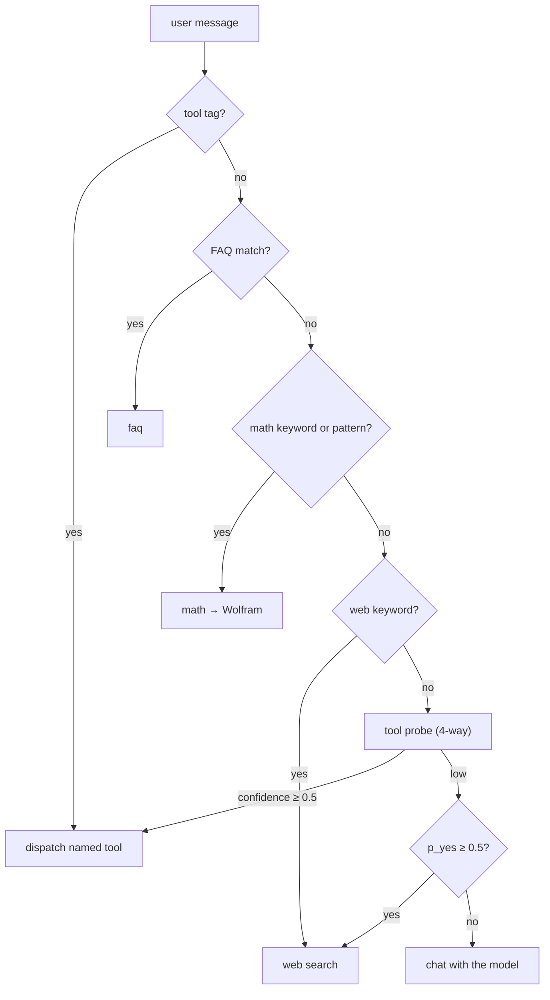

# Chapter 9 — Tools and Routing

> *When the crab does not know a fact, it asks a helper. The router decides which helper, if any.*

---

## The 5-year-old analogy

The crab has three friends:

| Friend | What it answers |
|---|---|
| **FAQ** | Questions about the crab itself, from a 20-row table |
| **Wolfram math** | Calculations such as `integrate x^2` |
| **Web search** | Current facts and news |

The router checks in a fixed order: an explicit tool tag first, then keywords, then a tiny learned probe, then an out-of-scope escalation.



---

## The router code

`hermitlm/tools/router.py:25-28` defines the patterns:

```python
25: TOOL_TAG_RE = re.compile(r"<tool>(\w+)\((.*?)\)</tool>", re.DOTALL)
26: MATH_RE = re.compile(r"\d\s*[+\-*/=]\s*\d")
27: MATH_KW = ["solve","integrate","differentiate","derivative","equation","factor","simplify","limit","matrix","sin","cos","tan"]
28: WEB_KW = ["latest","news","today","current","who is","search","explain"]
```

`parse_tool_tag()` (`router.py:33-37`) returns a lowercased name and its argument:

```python
33: def parse_tool_tag(text):
34:     m = TOOL_TAG_RE.search(text or "")
35:     if not m:
36:         return None
37:     return m.group(1).lower(), m.group(2).strip()
```

Accepted names (`router.py:45-50`):

| Tag name | Tool |
|---|---|
| `math`, `wolfram` | Wolfram alpha math |
| `search`, `web` | DuckDuckGo-style web search |
| `faq` | Built-in FAQ table |

Example: `<tool>math(integrate x^2)</tool>` calls the math tool with the argument `integrate x^2`.

> The router looks for tags in the **user message** (`router.py:42`). It does not rescan generated text for tags, even though the module docstring suggests the model can emit them.

---

## Keyword routing

`route()` (`router.py:39-62`) runs a cascade:

```python
39: def route(user_input):
40:     """Return (tool_name, result) or (None, None) if no tool applies."""
41:     q = user_input.lower()
42:     tag = parse_tool_tag(user_input)
43:     if tag:
44:         name, arg = tag
45:         if name in ("math", "wolfram"):
46:             return name, _wolfram(arg or user_input)
...
51:     faq = _faq(user_input)
52:     if faq:
53:         return "faq", faq
54:     if _hit(MATH_KW, q) or MATH_RE.search(q):
55:         r = _wolfram(user_input)
56:         if r:
57:             return "math", r
58:     if _hit(WEB_KW, q):
59:         r = _web(user_input)
60:         if r:
61:             return "web", r
62:     return None, None
```

`_hit()` (`router.py:30-31`) uses word-boundary regular expressions, so `sin` matches the word "sin" but not "single".

### Worked routing examples

| Message | First match | Tool |
|---|---|---|
| `hello crab` | FAQ table has a greeting entry | `faq` |
| `integrate x^2` | `MATH_KW` contains `integrate` | `math` |
| `what is 2+7` | `MATH_RE` matches `2+7` | `math` |
| `latest AI news` | `WEB_KW` contains `latest` and `news` | `web` |
| `who is Elon Musk?` | `WEB_KW` contains `who is` | `web` |
| `the water feels calm today` | no keyword | chat or probe |

`README.md:241-246` reports that keyword routing is **93% precise when it fires**. The tool probe handles the residue.

---

## The tool probe

`scripts/train_tool_probe.py:28` defines four classes:

```python
28: TOOL_CLASSES = ["math", "web", "faq", "chat"]
```

Training data (`data/tool_train.jsonl`, 5,038 rows) is built by `scripts/build_tool_data.py:374-405`:

```
3 × 1,200 templates (math, web, faq) = 3,600
+ 1,200 chat negatives from train.jsonl
+ 160 natural train queries
+ 50 natural web queries
+ 28 hard negatives (chat/FAQ with web trigger words)
= 5,038 rows
```

`data/tool_eval.jsonl` has 80 rows, exactly 20 per class.

The head is a linear classifier on the frozen final hidden state (chapter 10). The shipped artifact stores:

| Property | Value |
|---|---|
| `head.weight` | shape `(4, 320)` |
| `head.bias` | shape `(4,)` |
| `temperature` | 0.6785627417882039 |
| `eval_accuracy` | 0.7250 |
| `classes` | `["math", "web", "faq", "chat"]` |

Per-class accuracy on the 80-row eval set: math 0.80 (16/20), web 0.65 (13/20), faq 0.60 (12/20), chat 0.85 (17/20). Total `58/80 = 0.725`.

---

## The full cascade

`router.py:158-184`:

```python
158: def route_with_intent(user_input, confused_threshold=None, tool_threshold=None):
...
166:     tool, result = route(user_input)
167:     intent = classify_intent(user_input)
168:     if tool is None:
169:         decision = classify_tool(user_input)
170:         threshold = TOOL_THRESHOLD if tool_threshold is None else tool_threshold
171:         if decision is not None and decision["confidence"] >= threshold:
172:             probe_tool, probe_result = _dispatch_probe(decision["label"], user_input)
...
175:     if tool is None and intent is not None:
176:         threshold = YES_THRESHOLD if confused_threshold is None else confused_threshold
177:         if intent.get("p_yes", intent["p_confused"]) >= threshold:
178:             try:
179:                 web_result = _web(user_input)
```

Settings (`hermitlm/settings.py:20-25`):

| Threshold | Value | Meaning |
|---|---:|---|
| `YES_THRESHOLD` | 0.5 | Calibrated out-of-scope probability that triggers web search |
| `CONFUSED_THRESHOLD` | 0.9 | Legacy fallback for probes without `head_yes` |
| `TOOL_THRESHOLD` | 0.5 | Minimum probe confidence to dispatch a tool |
| `BEST_OF` | 3 | Candidates sampled before score-head reranking |
| `CLARIFY_THRESHOLD` | 0.75 | Below this confidence, ask a clarifying question |

### Worked escalation example

For a message like `quantum entanglement photosynthesis`:

1. No tag, no FAQ hit, no keyword.
2. Tool probe returns `chat` with confidence 0.42, below 0.5, so no dispatch.
3. The yes head reports `p_yes = 0.97`, above 0.5.
4. Web search runs and its result becomes the reply.

With `p_yes = 0.10`, step 4 is skipped and the model answers normally.

---

## Clarifying questions and personas

The API asks for clarification when no tool fired, intent confidence is below 0.75, `p_yes < 0.5`, and two top intents are available:

```python
148:        if (
149:            _tool is None
150:            and CLARIFY
151:            and intent is not None
152:            and intent["confidence"] < CLARIFY_THRESHOLD
153:            and intent.get("p_yes", intent["p_confused"]) < YES_THRESHOLD
154:            and len(intent.get("top2", [])) == 2
155:        ):
```

Example: top intents `tank` and `sense` produce:

```text
Quick check before I scuttle ahead: is this about tank or sense?
```

The coarse intent also selects a persona (`hermitlm/tools/decision_model.py:57-65`):

| Coarse intent | Persona |
|---|---|
| `a` social | none |
| `b` needs | hungry |
| `c` tank | none |
| `d` sense | guard |
| `e` body | sleepy |
| `f` condition | sleepy |
| `g` mind | none |

When enabled, the API prefixes the prompt with `[<persona> crab] ` (`api.py:164-166`), matching persona variants in the training data.

---

## The helper tools

| Tool | File | What it does |
|---|---|---|
| FAQ | `hermitlm/tools/bot_faq.py` | 20 hand-written question/answer pairs, normalized by lowercase and punctuation removal |
| Math | `hermitlm/tools/math.py` | Wolfram Alpha query with `WOLFRAM_APP_ID`; API adds a random crab intro |
| Web | `hermitlm/tools/web.py` | DuckDuckGo HTML endpoint, returns titles and snippets |
| Memory | `hermitlm/tools/memory.py` | Three SQLite keys: `name`, `likes`, `location` |
| Artifacts | `hermitlm/tools/artifacts.py` | SHA-256 pinning of checkpoint, tokenizer and prompt template |

The browser has its own local math fallback (`web/math.js:204-229`) that handles arithmetic and polynomial calculus without a network call. `∫cx^e dx = c/(e+1)·x^(e+1)` for `e ≠ −1` (`math.js:190-197`); `d/dx cx^e = ce·x^(e−1)` (`math.js:199-201`).

---

## Math and calculations

### Tool probe accuracy on the eval set

```
math: 0.80 × 20 = 16 correct
web:  0.65 × 20 = 13 correct
faq:  0.60 × 20 = 12 correct
chat: 0.85 × 20 = 17 correct
total = 58 / 80 = 0.725
```

### Probe artifact size

```
head weights = (4 × 320 + 4) floats = 1,284
bytes at float32 = 1,284 × 4 = 5,136
file size = 7,685 bytes (includes metadata and hashes)
```

### Routing order as a short-circuit

For `n` checks with firing probabilities `p₁ … pₙ`, the probability that check `k` decides is:

```
P(decided at k) = (Π_{i<k} (1 − p_i)) × p_k
```

High-precision checks go first so they handle most cases before the slower probe runs.

---

## Code you should remember

| File and lines | What it does |
|---|---|
| `hermitlm/tools/router.py:25-37` | Tool tag and keyword patterns |
| `hermitlm/tools/router.py:39-62` | First four routing checks |
| `hermitlm/tools/router.py:158-184` | Probe dispatch and confusion escalation |
| `hermitlm/settings.py:20-25` | Threshold values |
| `hermitlm/runtime/api.py:148-176` | Clarify gate, persona prompt, best-of-N call |
| `scripts/build_tool_data.py:374-405` | Tool data construction |
| `web/math.js:190-201` | Local polynomial integration and differentiation |

---

**Next:** [Chapter 10 — The decision model](10_decision_model.md)
