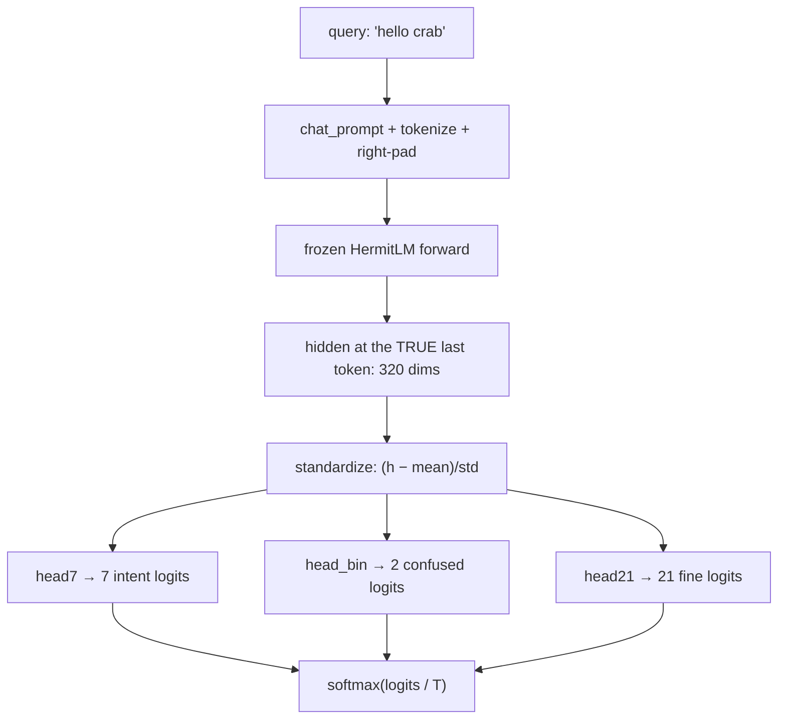

# Chapter 10 — The Decision Model

> *A tiny second brain reads one 320-number vector and answers: "what did they mean, and do I know it?"*

---

## The 5-year-old analogy

Asking an 8M-parameter crab "is this a greeting?" by prompting it in English is a bad idea. Zero-shot constrained decoding scored only **21.4% accuracy** (`eval_out/decision/report.json`). The prompt is out of distribution.

So instead we freeze the crab, peek at the note it wrote after reading your message — the hidden state — and train a **tiny linear head** on that note. The head is a few hundred numbers. It learns much faster and runs in one pass.



---

## The intent label system

`hermitlm/tools/decision_model.py:29-78` defines two label sets.

### 7 coarse intents

| Letter | Name | Covers |
|---|---|---|
| `a` | social | greeting, bye, lonely |
| `b` | needs | food, water, bubbles |
| `c` | tank | glass, environment, movement |
| `d` | sense | light, color, sound, noise |
| `e` | body | state, breathing |
| `f` | condition | temp_cold, temp_hot, night |
| `g` | mind | misc, confused, reflection |

### 21 fine intents

`FINE21_ORDER` is the alphabetical list: `breathing, bubbles, bye, color, confused, environment, food, glass, greeting, light, lonely, misc, movement, night, noise, reflection, sound, state, temp_cold, temp_hot, water`.

The coarse buckets on the 95k training set:

| Bucket | Approximate rows |
|---|---:|
| `a` social | 14,900 |
| `b` needs | 14,800 |
| `c` tank | 11,900 |
| `d` sense | 14,800 |
| `e` body | 11,900 |
| `f` condition | 9,000 |
| `g` mind | 17,900 |

---

## Where the feature comes from

`scripts/train_probe.py:32-49` extracts hidden states at the true last token of each right-padded prompt:

```python
38:    feats = []
39:    for i in range(0, len(queries), batch_size):
40:        batch = queries[i : i + batch_size]
41:        ids = [tokenizer.encode(chat_prompt(q)).ids[-max_seq_len:] for q in batch]
42:        width = max(len(s) for s in ids)
43:        padded = [s + [0] * (width - len(s)) for s in ids]
44:        idx = torch.tensor(padded, dtype=torch.long, device=device)
45:        _, hidden = model.forward_with_hidden_layers(idx)
46:        lengths = torch.tensor([len(s) for s in ids], dtype=torch.long)
47:        # Advanced indexing on Intel XPU hits Level Zero limits: gather on CPU.
48:        feats.append(hidden.cpu()[torch.arange(len(batch)), lengths - 1, :])
49:    return torch.cat(feats)
```

The model is frozen. `forward_with_hidden_layers` (`model.py:155-168`) returns all six block outputs, so the trainer can pick the best layer.

**Right padding is essential.** Adding zeros to the left would shift every learned position embedding, and `README.md:210-211` records a 30-point accuracy loss when that happened.

---

## The linear head

`hermitlm/tools/heads.py:36-41`:

```python
36:    def scores(self, hidden: torch.Tensor) -> torch.Tensor:
37:        x = (hidden - self.mean.to(hidden.device)) / self.std.to(hidden.device)
38:        return x @ self.weight.to(hidden.device).T + self.bias.to(hidden.device)
39:
40:    def log_probs(self, hidden: torch.Tensor) -> torch.Tensor:
41:        return torch.log_softmax(self.scores(hidden) / self.temperature, dim=-1)
```

For a hidden vector `h` and a head with weight matrix `W`, bias `b`, mean `μ`, standard deviation `σ` and temperature `T`:

$$ \Large x = \frac{h-\mu}{\sigma} $$

$$ \Large s = W x + b $$

$$ \Large \log p_c = \frac{s_c}{T} - \log\sum_j \exp\left(\frac{s_j}{T}\right) $$

The shipped artifact uses the older "legacy" form (`decision_model.py:263-279`): `scores = linear(hidden) / temperature`, then `log_softmax`.

### Shipped head shapes and temperatures

From `checkpoints/decision_probe.pt` and `web/probe.json`:

| Head | Weight shape | Bias shape | Temperature |
|---|---|---|---:|
| 7-way coarse | `(7, 320)` | `(7,)` | 1.2300633189037424 |
| 2-way confused | `(2, 320)` | `(2,)` | 1.3310915924669515 |
| 21-way fine | `(21, 320)` | `(21,)` | 0.6638396919185293 |
| Tool 4-way | `(4, 320)` | `(4,)` | 0.6785627417882039 |

### Prediction

`decision_model.py:411-416`:

```python
411:    def predict(self, query: str) -> tuple[str, dict[str, float], float]:
412:        h = self._hidden(query, self.layer)
413:        proba7 = torch.exp(self._log_probs(self.head7, h, "coarse"))[0]
414:        proba = {letter: float(p) for letter, p in zip(OPTION_LETTERS, proba7.tolist())}
415:        p_confused = float(torch.exp(self._log_probs(self.head_bin, h, "confused"))[0, 1])
416:        return max(OPTION_LETTERS, key=lambda letter: proba[letter]), proba, p_confused
```

For a zero hidden vector, the coarse head emits only its biases. Those biases are `[-0.01427, -0.08197, -0.01813, 0.0085, -0.00159, -0.0419, 0.06219]`, and after division by `T = 1.23006` plus softmax the largest class is `g` (mind) at **0.1517**. The binary head's biases give `p_confused = sigmoid((0.00603 − 0.06934)/1.33109) = 0.4881`.

That is what "no information" looks like: nearly a uniform guess.

---

## Fitting a head: closed form, not gradient descent

`heads.py:94-99` solves ridge regression directly:

```python
94: def fit_ridge(x, y, alpha=1.0):
95:     x = _standardize(x)
96:     a = x.T @ x + alpha * torch.eye(x.size(1))
97:     y_mean = _one_hot(y, classes).mean(0)
98:     w = torch.linalg.solve(a, x.T @ (_one_hot(y, classes) - y_mean))
99:     return w.T, y_mean
```

The formula is:

$$ \Large A = X^T X + \alpha I $$

$$ \Large W^T = A^{-1} X^T (Y-\bar{y}) $$

$$ \Large b = \bar{y} $$

where `Y` is a one-hot label matrix and `ȳ` is the vector of class frequencies.

LDA is also available (`heads.py:102-123`) with Ledoit–Wolf shrinkage of the covariance matrix.

### Layer and solver selection

`heads.py:135-139` chooses candidate layers:

```python
135: def default_layers(num_layers: int) -> list[int]:
137:     first = -(-4 * num_layers // 10)   # ceil(0.4×6) = 3
138:     last = 9 * num_layers // 10        # floor(0.9×6) = 5
139:     return list(range(first, last + 1, 2)) or [num_layers // 2]
```

With 6 blocks this gives layers **[3, 5]**.

`select_head()` (`heads.py:155-191`) tries 7 ridge values (`α = 1e-2 … 1e4`) and LDA at each layer, uses 5-fold stratified cross-validation, and picks the candidate with the lowest out-of-fold NLL after temperature fitting.

---

## Calibration: making confidence honest

A head can rank classes correctly but still report silly probabilities. Calibration fixes the scale without changing the ranking.

### Platt-smoothed targets

`calibration.py:29-44`:

```python
38:    targets = targets.detach().to(dtype=torch.long)
39:    counts = torch.bincount(targets, minlength=n_classes).to(dtype=torch.float64)
40:    own = (counts[targets] + 1.0) / (counts[targets] + 2.0)
41:    rest = (1.0 - own) / (n_classes - 1)
42:    out = rest.unsqueeze(1).expand(targets.numel(), n_classes).clone()
43:    out[torch.arange(targets.numel()), targets] = own
44:    return out
```

For a class with `n_c` examples:

$$ \Large \text{target}_{\text{own}} = \frac{n_c+1}{n_c+2} $$

$$ \Large \text{target}_{\text{rest}} = \frac{1-\text{target}_{\text{own}}}{K-1} $$

Worked example from the tests (`tests/test_calibration.py:11-16`), labels `[0,0,0,1]` with `K = 2`:

- class 0 appears 3 times → `target_own = (3+1)/(3+2) = 0.8`
- class 1 appears once → `target_own = (1+1)/(1+2) = 2/3`

So rows with label 0 get target `[0.8, 0.2]` and the label-1 row gets `[1/3, 2/3]`. Smoothing stops a near-separable head from claiming 100% confidence.

### Temperature by golden-section search

`calibration.py:81-146` searches `t = log T` in `[−3, 3]` to minimize:

$$ \Large \text{NLL}(t) = \text{cross-entropy}(s \cdot e^{-t}, \text{targets}) $$

$$ \Large T^* = \exp(t^*) $$

Binary heads and some multiclass cases use Platt targets instead of the raw labels. The search uses the golden ratio `φ⁻¹ = (√5 − 1)/2 ≈ 0.6180`, tolerance `1e-4`, at most 100 iterations. If the objective is flat, the function returns `T = 1.0`.

Worked example with logits `[2, 1, 0]`:

| T | softmax |
|---|---|
| 1.0 | `[0.6652, 0.2447, 0.0900]` |
| 1.2301 (shipped coarse T) | `[0.6097, 0.2704, 0.1199]` |
| 3.0 (zero-shot fitted T) | `[0.4484, 0.3213, 0.2302]` |

Larger T flattens the distribution.

### Prior correction

`hermitlm/tools/prior.py:10-24` fits a class prior from an unlabelled pool and applies:

The pool's mean predicted probability for class `c` is written `\bar{p}_c`. It is clamped, normalized, then used to correct the log-probability:

$$ \Large \pi_c = \frac{\max(\bar{p}_c, 10^{-6})}{\sum_j \max(\bar{p}_j, 10^{-6})} $$

$$ \Large \text{corrected}_c = \log p_c - \lambda \log \pi_c $$

$$ \Large p = \text{softmax}(\text{corrected}) $$

with `0 ≤ λ ≤ 1`. The browser does the same in `web/intent.js:21-32`.

The prior is fitted without labels: `scripts/fit_probe_prior.py` runs the probe heads over an
unlabelled query pool and stores `priors` / `prior_lambda` in the artifact. `export_probe.py`
copies both into `web/probe.json`, so the API and browser apply the same correction. The shipped
probe carries `prior_lambda = 0.5`; `classify_intent()` reports `level: "L0"` when it is active
and `level: "raw"` when no coarse prior is present.

### Option-order rotation

Zero-shot constrained decoding scores the displayed letters `a`–`g`, and the model has a strong
position/letter bias. `option_assignment(shift)` rotates which class each letter names, the
forward pass is repeated for `rotation_shifts(k)` (two evenly spaced passes by default), and the
per-class log-probabilities are averaged before the softmax:

$$ \Large \text{assignment}_s = \text{rotate}([a,b,c,d,e,f,g], s) $$

$$ \Large \text{letter log-prob} = \log\,\text{softmax}\left(\frac{\text{letter logits}}{T}\right) $$

$$ \Large \text{class score}_s(c) = \text{log-prob}_s\left(\text{letter}_s(c)\right) $$

$$ \Large \text{class score}(c) = \frac{1}{|S|}\sum_{s\in S} \text{class score}_s(c) $$

`scripts/eval_decision.py` reports an `order_flip` section that permutes the assignment and
compares predictions. On the zero-shot path the flip rate drops from `1.0` (single pass) to
`0.60` with L0 rotation; probe heads use a fixed prompt and therefore report `rotations: 1`.

### Yes/no and score heads

Two extra heads live in the same pinned artifact, so a stale head file still fails the SHA-256
check. `scripts/train_yes_score_heads.py` fits both on frozen final-layer hidden states and
exports them for the browser.

- `head_yes`: a 2-way classifier trained on `type == "confused"` with balanced sampling. Class 1
  means "yes, this is out of scope". Its temperature is fitted with `fit_temperature()` (binary
  targets get Platt smoothing). `classify_intent()` returns `p_yes`, and the router escalates when
  `p_yes >= HERMIT_YES_THRESHOLD` (0.5). Older artifacts fall back to `p_confused`.
- `head_score`: a 5-way classifier over reply-quality levels. Weak supervision comes from
  `context_score(query, reply)` in `reward.py` — the persona reward plus a bounded topical
  overlap bonus — fitted on replies sampled from the model itself so training matches runtime.
  Levels are rank-based bins with strictly increasing centres. The ranker uses
  `expected = sum(k * p_k)`; it beats the heuristic reward on human eval NLL
  (1.2578 vs 1.3780 in `eval_out/aux_heads/report.md`).

`HermitInference.best_of_n()` ranks candidates by `expected` when the probe has a score head and
falls back to `score_response()` otherwise. `POST /chat` logs the chosen candidate's `expected`
in `intent_log.expected_score`.

---

## Metrics

All four live in `hermitlm/tools/metrics.py:26-74`.

| Metric | Formula |
|---|---|
| Accuracy | `mean(argmax(p) == y)` |
| NLL | `−mean(log(clamp(p[i, y_i], 1e-12)))` |
| ECE | `Σ_b (n_b/n) · |mean(conf_b) − mean(correct_b)|` over 10 bins |
| Macro F1 | `(1/K) Σ_c 2·P_c·R_c / (P_c + R_c)` |

### ECE worked example

From `eval_out/decision/report.json`, all 1,000 zero-shot rows fall in the confidence bin `(0.10, 0.20]` with mean confidence `0.17` and accuracy `0.214`:

$$ \Large \text{ECE} = 1.0 \times |0.17 - 0.214| = 0.044 $$

That matches the report exactly. After calibrating with `T = 3`, mean confidence becomes `0.1516` and `ECE = |0.1516 − 0.214| = 0.0624`: NLL improved from 1.9497 to 1.9455 but ECE got worse.

### NLL and ECE from a tiny example

With `p = [[0.8, 0.2], [0.6, 0.4]]` and targets `[0, 0]`:

$$ \Large \text{NLL} = -\frac{\ln 0.8 + \ln 0.6}{2} = -\frac{-0.2231 - 0.5108}{2} = 0.3670 $$

With targets `[0, 1]`, predictions are `[0, 0]` (both argmax 0), so accuracy is `0.5`. ECE uses confidences `0.8` and `0.6` with correctness `1` and `0`:

$$ \Large \text{ECE} = \frac{|0.8-1| + |0.6-0|}{2} = \frac{0.2+0.6}{2} = 0.4 $$

### Bootstrap confidence intervals

`metrics.py:77-93` resamples rows `n_boot` times with replacement and takes the 2.5th and 97.5th percentiles. The eval script defaults to 1,000 resamples (`scripts/eval_decision.py:284`). Paired bootstrap (`metrics.py:96-120`) computes intervals for `stat_calibrated − stat_uncalibrated` on the same draws.

---

## Results: templates vs humans

| Setting | 7-way accuracy | Notes |
|---|---:|---|
| Zero-shot constrained decoding | 0.214 | `eval_out/decision/report.json`, n=1000 |
| Frozen-head probe, template eval | 1.000 | `eval_out/decision_probe/report.json`, n=4000 |
| Frozen-head probe, hand-written eval | 0.6212 | README, 126 rows, with L0 prior at λ=0.5 |
| 21-way on hand-written eval | 0.4848 | README |

The huge gap between template and human scores is the honest generalization gap. The README calls the template numbers flattering and says the next fix is better data, not a bigger head.

Other shipped template numbers:

- NLL `0.0015`, ECE `0.0012` (`README.md:184-185`)
- confused detector precision 1.0, recall 1.0
- 21-way accuracy 0.9982, macro F1 0.9971 (`eval_out/decision_probe/report.json`)
- tool probe accuracy 0.7250 on 80 hand-written queries

---

## Artifact pinning

`hermitlm/tools/artifacts.py:27-51,54-97` stores and verifies SHA-256 hashes of three things:

$$ \Large \text{checkpoint fingerprint} = \texttt{c52c0f23}\ldots $$

$$ \Large \text{tokenizer fingerprint} = \texttt{2cb03484}\ldots $$

$$ \Large \text{prompt fingerprint} = \texttt{56b51898}\ldots $$

$$ \Large \text{schema version} = 2, \quad \text{dtype} = \text{float32} $$

Loading a head after a retrain or a prompt-template change raises an error instead of scoring with stale weights.

---

## Export to the browser

`decision_model.export_probe()` (`decision_model.py:496-577`) writes `web/probe.json` with `options`, `names`, `fine_options`, the three heads and their temperatures, the `head_yes` / `head_score` pair with `score_levels` / `score_labels`, the `priors` / `prior_lambda` pair, and the hashes. `scripts/export_probe.py` is a 23-line wrapper. All heads are exported for both selection-format and legacy artifacts.

When a head has standardization, `FittedHead.effective()` (`heads.py:43-47`) folds it into plain weights for JSON:

$$ \Large w_{\text{eff}} = \frac{W}{\sigma} $$

$$ \Large b_{\text{eff}} = b - \frac{\mu}{\sigma}W^T $$

Then the browser needs only a dot product, a prior subtraction and a softmax (`web/intent.js:21-85`).

---

## Math and calculations

### Number of head parameters

$$ \Large \text{coarse head parameters} = 7 \times 320 + 7 = 2{,}247 $$

$$ \Large \text{binary head parameters} = 2 \times 320 + 2 = 642 $$

$$ \Large \text{fine head parameters} = 21 \times 320 + 21 = 6{,}741 $$

$$ \Large \text{tool head parameters} = 4 \times 320 + 4 = 1{,}284 $$

$$ \Large \text{probe total} = 2{,}247+642+6{,}741+1{,}284 = 10{,}914 $$

That is 0.13% of the 8,453,120-parameter chat model.

### Probe artifact size

$$ \Large \text{weight bytes} = 37 \times 320 \times 4 = 47{,}360 \text{ bytes} $$

$$ \Large \text{bias bytes} = 37 \times 4 = 148 \text{ bytes} $$

$$ \Large \text{probe bytes} = 47{,}360 + 148 = 47{,}508 \text{ bytes} $$

$$ \Large \text{browser JSON} = 262{,}502 \text{ bytes} $$

$$ \Large \text{JSON to probe ratio} = \frac{262{,}502}{47{,}508} = 5.5\times $$

### Confusion rate from the eval split

$$ \Large \text{calibration rows} = \min\left(1{,}000, \frac{5{,}000}{2}\right) = 1{,}000 $$

$$ \Large \text{test rows} = 5{,}000 - 1{,}000 = 4{,}000 $$

$$ \Large \text{confused rows in test} = 268 $$

$$ \Large \text{confused rate} = \frac{268}{4{,}000} = 6.7\% $$

### Probability of an intent under the shipped temperature

If the coarse head produces scores `[0.5, 0.4, 0.3, 0.2, 0.1, 0.0, −0.1]` and `T = 1.23006`:

$$ \Large \text{scaled scores} = [0.4065, 0.3252, 0.2439, 0.1626, 0.0813, 0, -0.0813] $$

$$ \Large \text{probabilities} = \text{softmax}(\text{scaled scores}) \approx [0.1799, 0.1659, 0.1529, 0.1410, 0.1300, 0.1198, 0.1105] $$

---

## Code you should remember

| File and lines | What it does |
|---|---|
| `hermitlm/tools/decision_model.py:29-78` | Intent label sets and persona map |
| `hermitlm/tools/decision_model.py:378-420` | Hidden-state extraction, prior application and prediction |
| `hermitlm/tools/decision_model.py:111-184` | Label-token resolution, option rotation and prompt template |
| `hermitlm/tools/heads.py:36-47` | Scoring, log-softmax, export folding |
| `hermitlm/tools/heads.py:94-139` | Ridge, LDA, layer grid |
| `hermitlm/tools/calibration.py:29-146` | Platt targets and temperature search |
| `hermitlm/tools/prior.py:10-24` | Prior fit and correction |
| `hermitlm/tools/metrics.py:26-120` | Accuracy, NLL, ECE, macro F1, bootstrap |
| `scripts/train_probe.py:32-49` | Frozen hidden-state extraction |
| `scripts/train_yes_score_heads.py` | Yes/no and score head fitting |
| `scripts/eval_aux_heads.py` | Score-head vs heuristic NLL report |
| `web/intent.js:21-85` | Browser-side probe inference |

---

**Next:** [Chapter 11 — RLHF with PPO and DPO](11_rlhf.md)
