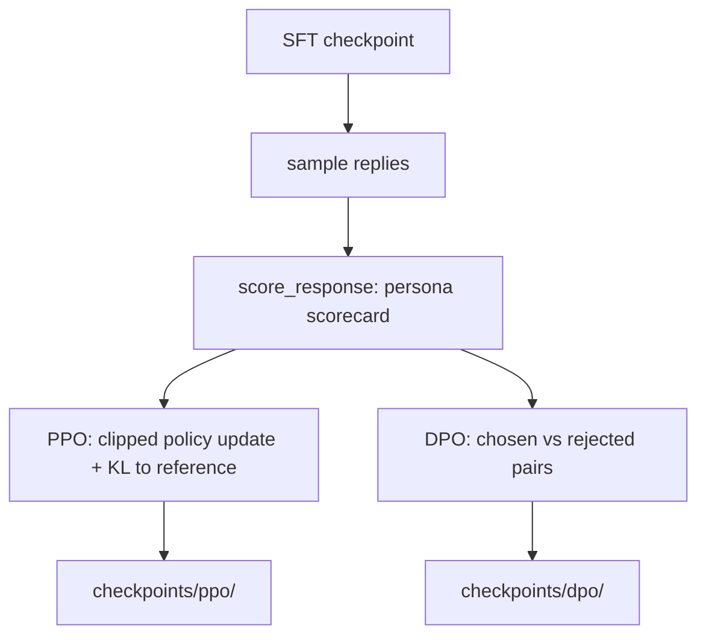

# Chapter 11 — RLHF with PPO and DPO

> *Supervised training teaches the crab to talk. Preference tuning teaches it to stay in character.*

---

## The 5-year-old analogy

After SFT the crab can speak, but it sometimes breaks character and says "As an AI language model...". To fix that we give it a **scorecard**:

- crab words: plus points
- repetition, shouting, boring length: minus points
- breaking character: big minus points

Then we either (a) let it try, score the tries, and nudge it toward better ones — that is **PPO**; or (b) show it pairs of replies, one better one worse, and teach it to prefer the better one — that is **DPO**.

Both stages are optional. The shipped artifact is the SFT model.



---

## The persona reward

`hermitlm/training/reward.py:111-125`:

```python
111: def score_response(text):
114:     text = text.strip()
115:     if not text:
116:         return -3.0
117:
118:     reward = 0.0
119:     reward += 2.0 * min(_word_overlap_score(text), _OVERLAP_CAP)
120:     reward -= 1.5 * _repetition_penalty(text)
121:     reward -= 1.0 * _length_penalty(text)
122:     reward -= 1.0 * _style_penalty(text)
123:     reward -= 3.0 * _break_character_penalty(text)
124:
125:     return reward
```

The formula:

$$
\begin{aligned}
R(text) &= 2.0 \cdot \min(overlap, 0.4) \\
        &- 1.5 \cdot repetition \\
        &- 1.0 \cdot length_{penalty} \\
        &- 1.0 \cdot style_{penalty} \\
        &- 3.0 \cdot break_{penalty}
\end{aligned}
$$

An empty reply returns `−3.0`.

### The five terms

| Term | Formula | Meaning |
|---|---|---|
| `overlap` | `# of words in the 155-word persona lexicon / # of words` | crab vocabulary use, capped at 0.4 |
| `repetition` | `1 − #unique bigrams / #bigrams` | repeated word pairs |
| `length_penalty` | `(3−n)/3` if `n<3`; `(n−40)/40` if `n>40`; else 0 | too short or too long |
| `style_penalty` | `#uppercase letters / #letters` | shouting |
| `break_penalty` | number of 12 break phrases found | "as a language model", "i cannot", etc. |

`_OVERLAP_CAP = 0.4` (`reward.py:108`) means the best possible overlap credit is `2 × 0.4 = +0.8`.

### Worked examples computed with the repository's own code

| Text | overlap | rep | len | style | break | Score |
|---|---:|---:|---:|---:|---:|---:|
| `i am a crab. i live in water. i consume kelp bits.` | 0.3333 | 0 | 0 | 0 | 0 | **+0.6667** |
| `the small cave appears calmer now. the current carries bubbles near the glass.` | 0.3846 | 0 | 0 | 0 | 0 | **+0.7692** |
| `water water water water water water water water` | 1.0 → 0.4 | 0.8571 | 0 | 0 | 0 | **−0.4857** |
| `HELLO CRAB!!!` | 0.5 → 0.4 | 0 | 0.3333 | 1.0 | 0 | **−0.5333** |
| `As an AI language model I cannot answer. I'm sorry.` | 0 | 0 | 0 | 0.1282 | 4 | **−12.1282** |
| `""` | — | — | 1.0 | — | — | **−3.0** |

For the keyword-stuffing example: overlap credit `+0.8`, repetition penalty `1.5 × (1 − 1/5) = 1.5 × 0.8 = 1.2`, so `0.8 − 1.2 = −0.4` before other terms.

This scorecard is also used for best-of-N reranking (chapter 8) and for building DPO pairs.

---

## PPO: Proximal Policy Optimization

`hermitlm/config.py:46-74` holds the settings:

| Setting | Value | Meaning |
|---|---:|---|
| `total_iterations` | 200 | rollout-and-update rounds |
| `rollout_batch_size` | 16 | prompts sampled per round |
| `ppo_epochs` | 4 | passes over each rollout |
| `minibatch_size` | 8 | minibatches per epoch |
| `max_new_tokens` | 48 | reply length during rollout |
| `temperature` | 1.0 | sampling temperature |
| `top_k` | 50 | sampling filter |
| `learning_rate` | 1e−5 | 1/20 of the SFT peak |
| `kl_coef` | 0.15 | penalty for drifting from SFT |
| `clip_epsilon` | 0.2 | trust-region window |
| `gamma` | 1.0 | discount factor |
| `lam` | 0.95 | GAE bias-variance knob |
| `value_coef` | 0.5 | value-loss weight |
| `entropy_coef` | 0.01 | entropy bonus |
| `max_grad_norm` | 1.0 | gradient clipping |

Dropout is forced to 0.0 (`ppo.py:319`) so old and new log-probabilities are comparable.

### The actor-critic

`ppo.py:16-28` subclasses `HermitLM` and adds a value head:

```python
16: class ActorCriticHermitLM(HermitLM):
17:     def __init__(self, config):
18:         super().__init__(config)
19:         self.value_head = nn.Linear(config.d_model, 1)
20:         nn.init.zeros_(self.value_head.weight)
21:         nn.init.zeros_(self.value_head.bias)
```

The value head starts at zero, so initial value predictions are 0. When saving, `extract_policy_state_dict()` (`ppo.py:290-291`) removes this head, so PPO checkpoints are plain `HermitLM` models.

### Token rewards

For each response token `t` (`ppo.py:202-204`):

$$
\begin{aligned}
kl_{t}     = \log \pi_{old}(a_{t}|s_{t}) - \log \pi_{ref}(a_{t}|s_{t}) \\
r_{t}      = -0.15 \cdot kl_{t} \\
r_{T}      = r_{T} + score_{response}(reply)     (final response token only)
\end{aligned}
$$

The k1 KL estimator is always non-negative in expectation. It penalizes moving away from the frozen SFT model. The persona reward is added only at the last token so it does not bias every step.

### GAE advantages

`ppo.py:212-219`:

```python
212:        for t in reversed(range(T)):
213:            next_value = vals[t + 1] if t + 1 < T else 0.0
214:            delta = token_rewards[t] + pc.gamma * next_value - vals[t]
215:            last_gae = delta + pc.gamma * pc.lam * last_gae
216:            adv[t] = last_gae
217:
218:        advantages[b, idxs] = adv
219:        returns[b, idxs] = adv + vals
```

Formally, with `γ = 1.0` and `λ = 0.95`:

$$
\begin{aligned}
\delta_{t}   = r_{t} + \gamma V_{t+1} - V_{t}          (V_{T} := 0) \\
\hat{A}_t   = \delta_{t} + \gamma\lambda \hat{A}_{t+1}               (backwards) \\
R_{t}   = \hat{A}_t + V_{t}
\end{aligned}
$$

Advantages are then whitened across all response positions (`ppo.py:224-227`):

$$
\begin{aligned}
\hat{A}'_t = (\hat{A}_t - mean(\hat{A})) / \max(std(\hat{A}), 1e-6)
\end{aligned}
$$

### The clipped objective

`ppo.py:263-271`:

```python
263:            ratio = torch.exp(new_logprobs - mb_old_logprobs)
264:            surr1 = ratio * mb_advantages
265:            surr2 = torch.clamp(ratio, 1 - pc.clip_epsilon, 1 + pc.clip_epsilon) * mb_advantages
266:            policy_loss = -(torch.min(surr1, surr2) * mb_mask).sum() / denom
267:
268:            value_loss = ((new_values - mb_returns) ** 2 * mb_mask).sum() / denom
269:            entropy_bonus = (entropy * mb_mask).sum() / denom
270:
271:            loss = policy_loss + pc.value_coef * value_loss - pc.entropy_coef * entropy_bonus
```

The formulas:

$$
\begin{aligned}
r_{t}(\theta)     = \exp(\log \pi_{new}(a_{t}|s_{t}) - \log \pi_{old}(a_{t}|s_{t})) \\
L_{policy}   = -mean[ \min(r_{t} \hat{A}_t, clip(r_{t}, 0.8, 1.2) \hat{A}_t) ] \\
L_{value}    = mean[ (V_{new},t - R_{t})^2 ] \\
H          = -\sum_v p_{v} \log p_{v} \\
L_{total}    = L_{policy} + 0.5 \cdot L_{value} - 0.01 \cdot H
\end{aligned}
$$

The clip prevents a single update from changing the policy too much. If `r_t` would push above 1.2 or below 0.8, the surrogate stops giving extra reward.

### PPO worked example

Suppose `π_old = 0.20`, `π_new = 0.30`, `Â = +2.0`:

$$
\begin{aligned}
r = 0.30/0.20 = 1.5 \\
surr1 = 1.5 \times 2.0 = 3.0 \\
clip(1.5, 0.8, 1.2) = 1.2 \to surr2 = 1.2 \times 2.0 = 2.4 \\
\min(3.0, 2.4) = 2.4 \to policy contribution = -2.4
\end{aligned}
$$

Without clipping it would be −3.0. The clamp removed the extra incentive to make that large a jump.

### Work per PPO run

$$
\begin{aligned}
rollouts      = 16 \times 200 = 3,200 replies \\
minibatches   = 16 / 8 = 2 per epoch \\
optimizer steps = 4 epochs \times 2 minibatches \times 200 iterations = 1,600
\end{aligned}
$$

Checkpoints appear at iterations 50, 100, 150, 200 plus `ppo_final.pt`, matching the files on disk.

---

## DPO: Direct Preference Optimization

DPO skips the value network and the rollout loop. It needs only pairs of replies: one chosen, one rejected.

### Building pairs

`dpo.py:17-34` samples `n = 4` candidates per prompt at `temperature = 0.8`, `top_k = 40`, `max_new_tokens = 48`. It keeps the best and worst by `score_response`, but only if:

$$
\begin{aligned}
chosen_{text} \neq  rejected_{text} \\
score(chosen) - score(rejected) \geq  0.15
\end{aligned}
$$

The margin filter drops ambiguous pairs.

### The loss

`dpo.py:37-61`:

```python
37: def _logps(model, ids):
38:     logits, _ = model(ids)
39:     lp = F.log_softmax(logits[:, :-1], dim=-1)
40:     tgt = ids[:, 1:]
41:     return lp.gather(-1, tgt.unsqueeze(-1)).squeeze(-1)
...
53:     def _m(lp, m):
54:         if m is None:
55:             return lp.mean(-1)
56:         denom = m.sum(-1).clamp(min=1.0)
57:         return (lp * m).sum(-1) / denom
58:
59:     r_pi = _m(pi_chosen, mask_c) - _m(pi_rej, mask_r)
60:     r_ref = _m(ref_chosen, mask_c) - _m(ref_rej, mask_r)
61:     return -F.logsigmoid(beta * (r_pi - r_ref)).mean()
```

Let `ℓ_π(y|x)` be the mean log-probability over **completion tokens only** (the prompt is masked out):

$$
\begin{aligned}
\ell_\pi(y|x) = \sum_t m_{t} \log \pi(y_{t} | x, y_{<t}) / \sum_t m_{t} \\
r_\pi      = \ell_\pi(chosen|x) - \ell_\pi(rejected|x) \\
r_{ref}    = \ell_{ref}(chosen|x) - \ell_{ref}(rejected|x) \\
L_{DPO}    = -\log \sigma( \beta \cdot (r_\pi - r_{ref}) )        \beta = 0.1
\end{aligned}
$$

`σ(z) = 1/(1+e^(−z))`. Minimizing this loss increases the chosen log-probability relative to the reference and decreases the rejected one.

### DPO worked example

Suppose:

$$
\begin{aligned}
\ell_\pi(chosen) = -0.30    \ell_\pi(rejected) = -0.80   \to r_\pi = 0.50 \\
\ell_{ref}(chosen) = -0.35  \ell_{ref}(rejected) = -0.45  \to r_{ref} = 0.10
\end{aligned}
$$

Then:

$$
\begin{aligned}
z = \beta (r_\pi - r_{ref}) = 0.1 \times 0.40 = 0.04 \\
\sigma(0.04) = 1/(1 + e^{-0.04}) = 0.5100 \\
L_{DPO} = -\ln(0.5100) = 0.6733
\end{aligned}
$$

If the policy preferred the rejected reply, `r_π − r_ref` would be negative and the loss would be larger than `ln 2 ≈ 0.6931`.

### DPO settings and work

| Setting | Value |
|---|---:|
| `steps` | 200 |
| `beta` | 0.1 |
| `learning_rate` | 5e−6 |
| `batch` | 4 prompts |
| candidates per prompt | 4 |
| dropout | 0.0 |
| gradient clip | 1.0 |

$$
\begin{aligned}
generations = 200 \times 4 \times 4 = 3,200 \\
optimizer steps = 200 \\
learning rate ratio to SFT peak = 5e-6 / 2e-4 = 1/40
\end{aligned}
$$

Logged losses in `logs/dpo_margin.log` move from about 0.69 to 0.60, with 3 or 4 pairs retained out of 4 at most checkpoints.

---

## Results

| Checkpoint | Perplexity | Persona reward |
|---|---:|---:|
| SFT (`best_model.pt`) | 1.931 | 0.495 |
| PPO (`ppo_final.pt`) | 1.992 | **0.648** |
| DPO (`dpo_final.pt`) | 1.930 | 0.449 |

`eval_out/report.json` for the currently shipped model says perplexity 1.929 and reward 0.378. `README.md:149-151` explains that PPO and DPO values come from an earlier run and have not been reproduced on the newer data. Treat those rows as a demonstration that the stages work, not as the current production numbers.

---

## Math and calculations

### PPO optimizer-step count

$$
\begin{aligned}
iterations \times epochs \times (batch/minibatch) = 200 \times 4 \times (16/8) = 1,600
\end{aligned}
$$

### KL estimator

$$
\begin{aligned}
kl_{t} = \log \pi_{old} - \log \pi_{ref} \\
E[kl] \geq  0 by Gibbs' inequality \\
penalty = kl_{coef} \times \sum_t kl_{t} = 0.15 \times \sum_t kl_{t}
\end{aligned}
$$

### Clipping boundaries

$$
\begin{aligned}
lower = 1 - \varepsilon = 0.8 \\
upper = 1 + \varepsilon = 1.2
\end{aligned}
$$

A probability ratio of 1.5 is clamped to 1.2; 0.6 is clamped to 0.8.

### DPO implicit reward

The objective is equivalent to maximizing:

$$
\begin{aligned}
\beta \cdot [ &(\log \pi(chosen) - \log \pi_{ref}(chosen)) \\
             &- (\log \pi(rejected) - \log \pi_{ref}(rejected)) ]
\end{aligned}
$$

so DPO learns a reward function up to the scale factor `β`.

### Reward bounds

$$
\begin{aligned}
maximum overlap credit = +0.8 \\
maximum total reward   = +0.8      (all penalties zero) \\
empty reply            = -3.0 \\
each break phrase      = -3.0      (unbounded below)
\end{aligned}
$$

---

## Code you should remember

| File and lines | What it does |
|---|---|
| `hermitlm/training/reward.py:111-125` | Persona reward scorecard |
| `hermitlm/training/ppo.py:16-28` | Actor-critic with value head |
| `hermitlm/training/ppo.py:191-229` | KL rewards, GAE, whitening |
| `hermitlm/training/ppo.py:232-287` | Clipped surrogate and optimizer step |
| `hermitlm/training/dpo.py:17-34` | Pair construction and margin filter |
| `hermitlm/training/dpo.py:44-61` | DPO sigmoid loss |
| `hermitlm/config.py:46-74` | PPO hyperparameters |

---

**Next:** [Chapter 12 — Export and the browser](12_export_browser.md)
