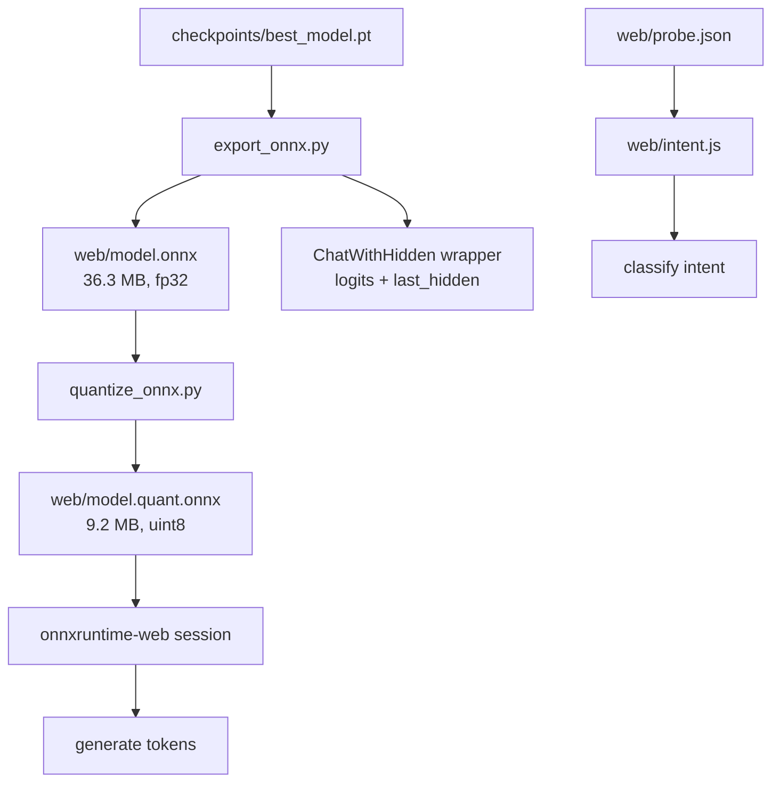
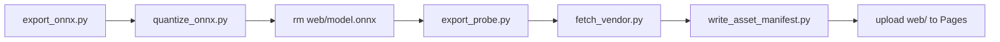

# Chapter 12 — Export and the Browser

> *The training rig stays on the workbench. A quantized copy of the model goes into the shop window.*

---

## The 5-year-old analogy

PyTorch is a big workshop full of tools. A browser is a small backpack. To fit the crab into the backpack we:

1. trace the model into a **portable recipe** (ONNX)
2. replace most 32-bit numbers with **8-bit numbers** (quantization)
3. let the browser run the recipe with **onnxruntime-web** on WASM

The result is 9,215,272 bytes instead of 36,282,163 bytes. The model still speaks crab.



---

## ONNX export

`scripts/export_onnx.py:22-46`:

```python
22:    # Export the hidden layer selected by the probe head, so the browser
23:    # computes exactly the features the head was fitted on.
24:    probe_path = Path("checkpoints/decision_probe.pt")
25:    layer = None
26:    if probe_path.exists():
27:        probe = torch.load(probe_path, map_location="cpu", weights_only=True)
28:        selection = probe.get("selection")
29:        if selection:
30:            layer = int(selection["layer"])
31:    wrapper = ChatWithHidden(model, layer=layer)
32:    dummy = torch.randint(0, config.vocab_size, (1, 8), dtype=torch.long)
33:
34:    onnx_path = output_dir / "model.onnx"
35:    torch.onnx.export(
36:        wrapper,
37:        (dummy,),
38:        str(onnx_path),
39:        input_names=["input_ids"],
40:        output_names=["logits", "last_hidden"],
41:        dynamic_axes={"input_ids": {1: "seq_len"}, "logits": {1: "seq_len"}},
42:        opset_version=opset,
43:        dynamo=False,
44:    )
```

Key choices:

| Choice | Reason |
|---|---|
| `ChatWithHidden` wrapper | One forward pass returns both logits and probe features |
| `dynamic_axes` | Sequence length is not fixed at 8; it grows as tokens are generated |
| `opset_version=17` | Compatibility with onnxruntime-web |
| `dynamo=False` | Legacy TorchScript exporter path |
| Copy `tokenizer.json` | The browser needs the exact vocabulary |

The shipped probe is a legacy artifact with no `selection` key, so `layer = None` and the wrapper uses the **final** hidden state (`model.py:229-231`).

Exported graph (inspected from the file itself):

| Property | Value |
|---|---|
| Input | `input_ids[1, seq_len]` |
| Outputs | `logits[1, seq_len, 2831]`, `last_hidden[1, 320]` |
| Nodes | 354 |
| Float32 initializers | 71 |

> The local `web/model.onnx` was exported from an older 2,831-vocabulary checkpoint. Deploy CI regenerates it from the current model. Chapter 1 notes this mismatch.

---

## Dynamic quantization

`scripts/quantize_onnx.py:6-15` is the whole script:

```python
 6: def main():
 7:     from onnxruntime.quantization import QuantType, quantize_dynamic
 9:     p = argparse.ArgumentParser()
10:     p.add_argument("--input", default="web/model.onnx")
11:     p.add_argument("--output", default="web/model.quant.onnx")
12:     a = p.parse_args()
13:     quantize_dynamic(Path(a.input), Path(a.output), weight_type=QuantType.QUInt8)
14:     inp, out = Path(a.input).stat().st_size, Path(a.output).stat().st_size
15:     print(f"{inp/1e6:.1f}MB -> {out/1e6:.1f}MB : {a.output}")
```

**Dynamic** means weights are quantized offline but activation scales are computed at runtime. No calibration dataset is needed.

The quantized graph contains:

- 66 uint8 weight arrays
- 31 `MatMulInteger` nodes (integer matrix products)
- 25 `DynamicQuantizeLinear` nodes (runtime activation quantization)
- 2 `DequantizeLinear` nodes (restore float for LayerNorm and output)

### The affine quantization formula

For a real value `r` mapped to an unsigned 8-bit integer `q ∈ [0, 255]`:

$$
\begin{aligned}
scale      = (r_{max} - r_{min}) / (q_{max} - q_{min}) \\
zero_{point} = clip( round(q_{min} - r_{min} / scale), 0, 255 ) \\
q          = clip( round(r / scale) + zero_{point}, 0, 255 ) \\
r_{hat}      = scale \times (q - zero_{point})
\end{aligned}
$$

Worked example with weights in `[−0.5, 0.5]`:

$$
\begin{aligned}
scale      = (0.5 - (-0.5)) / 255 = 1/255 = 0.00392157 \\
zero_{point} = round(0 - (-0.5)/0.00392157) = round(127.5) = 128 \\
r = 0.25  \to q = round(0.25/0.00392157) + 128 = 64 + 128 = 192 \\
r_{hat}     = 0.00392157 \times (192 - 128) = 0.25098
\end{aligned}
$$

The reconstruction error is about 0.001, small compared with model weight noise.

### Size math

$$
\begin{aligned}
fp32 file     = 36,282,163 bytes \\
uint8 file    =  9,215,272 bytes \\
ratio         = 36,282,163 / 9,215,272 = 3.937\times  \\
reduction     = 1 - 9,215,272/36,282,163 = 74.6\%
\end{aligned}
$$

Not every array shrinks 4×. LayerNorm scales, biases and scale/zero-point parameters stay float32, which is why the ratio is below 4.

---

## Probe export and the asset manifest

`scripts/export_probe.py:14-19` calls `export_probe()` to write `web/probe.json`. The JSON contains:

| Key | Value |
|---|---|
| `options` | `["a","b","c","d","e","f","g"]` |
| `fine_options` | 21 sorted fine labels |
| `head7`, `head_bin`, `head21` | weight and bias matrices |
| `temperature7`, `temperature_bin`, `temperature21` | 1.23006, 1.33109, 0.66384 |
| `head_yes`, `temperature_yes` | calibrated out-of-scope head |
| `head_score`, `temperature_score` | 5-way reply-quality head |
| `score_levels`, `score_thresholds`, `score_labels` | level centres, bucket edges and label tokens (`0`–`4`) |
| `priors` | label-free coarse/confused/fine/yes/score priors fitted by `scripts/fit_probe_prior.py` and `scripts/train_yes_score_heads.py` |
| `prior_lambda` | 0.5 |
| `schema_version` | 2 |
| three SHA-256 hashes | checkpoint, tokenizer, prompt template |

File size: 262,502 bytes. `export_probe()` emits all heads and priors for both selection-format
and legacy artifacts, so the browser and the API apply the same corrections.

`scripts/write_asset_manifest.py:21-33` writes `asset-manifest.json` with the SHA-256 and byte size of `model.quant.onnx`, `tokenizer.json` and `probe.json`. The browser uses the model hash as the Cache API version (`web/model.js:9-18`):

```javascript
 9: export async function fetchAssetVersion() {
10:   try {
11:     const res = await fetch("./asset-manifest.json", { cache: "no-store" });
12:     if (!res.ok) return DEFAULT_ASSET_VERSION;
13:     const manifest = await res.json();
14:     return (manifest["model.quant.onnx"] || {}).sha256 || DEFAULT_ASSET_VERSION;
```

A new deploy therefore cannot pair stale cached weights with a fresh probe.

---

## Browser session and inference

`web/model.js:157-173` creates the session:

```javascript
157:  static async load(modelUrl, { onProgress, version } = {}) {
158:    const data = await HermitModel.fetchBuffer(modelUrl, { version, onProgress: ... });
168:    const session = await ort.InferenceSession.create(data, {
169:      executionProviders: ["wasm"],
170:    });
172:    return new HermitModel(session);
173:  }
```

`web/index.html:584-620` starts everything: download runtime, load tokenizer and quantized model (fall back to fp32), load the probe, enable the input box.

Each generation step (`web/model.js:208-228`):

```javascript
208:      const inputTensor = new ort.Tensor(
209:        "int64",
210:        BigInt64Array.from(context.map((id) => BigInt(id))),
211:        [1, context.length]
212:      );
213:
214:      const results = await this.session.run({ input_ids: inputTensor });
215:      const logits = results.logits;
218:      const lastLogits = logits.data.subarray(
219:        (T - 1) * vocabSize,
220:        T * vocabSize
221:      );
223:      const nextId = sampleNext(lastLogits, temperature, topK, topP);
```

`classify()` (`web/model.js:183-196`) uses the **same session** and reads `results.last_hidden.data`, so classification costs one extra forward pass and no extra download.

The browser sampler implements temperature, top-k and top-p (chapter 8). `web/intent.js:37-85` runs the heads with temperature scaling, the exported priors and softmax. `p_yes` comes from `head_yes` when present (falling back to `head_bin`), and out-of-scope escalation uses `YES_THRESHOLD = 0.5`, matching `HERMIT_YES_THRESHOLD` in the API.

---

## Deploy workflow

`.github/workflows/deploy.yml` runs on every push to `main`:



Dropping the fp32 model keeps the upload around 6 MB. The comment in the workflow says this avoids the action timeout. Local and self-hosted copies keep `model.onnx` and can use the fp32 fallback (`web/index.html:597-602`).

Vendored runtime: `web/vendor/` pins onnxruntime-web **1.19.2** with SHA-256 checks (`scripts/fetch_vendor.py:14-19`).

---

## Math and calculations

### Bytes per weight

$$
\begin{aligned}
fp32 weight      = 4 bytes \\
uint8 weight     = 1 byte \\
naive saving     = 3 bytes per weight = 75\% \\
observed saving  = 74.6\%
\end{aligned}
$$

The 0.4 percentage-point gap is metadata and float32 parameters that were not quantized.

### Quantized tensor sizes

For a 3,774 × 320 token-embedding matrix:

$$
\begin{aligned}
fp32 = 3,774 \times 320 \times 4 = 4,830,720 bytes \\
uint8 = 3,774 \times 320     = 1,207,680 bytes \\
saved = 3,623,040 bytes
\end{aligned}
$$

### Cache key

$$
\begin{aligned}
manifest hash = sha256(model.quant.onnx) \\
cache name    = "hermit-assets-" + hash
\end{aligned}
$$

Without the manifest, `DEFAULT_ASSET_VERSION = "v2"` is used and the cache name is `hermit-assets-v2` (`web/model.js:7`).

### Browser token work

$$
\begin{aligned}
one step = one full forward over (prompt_{len} + generated_{so\_far}) tokens \\
80 generated tokens = 80 forwards \\
context capped at 512 tokens
\end{aligned}
$$

---

## Code you should remember

| File and lines | What it does |
|---|---|
| `hermitlm/training/model.py:216-233` | ONNX wrapper with two outputs |
| `scripts/export_onnx.py:22-46` | Export with dynamic sequence axis |
| `scripts/quantize_onnx.py:6-15` | uint8 dynamic quantization |
| `scripts/export_probe.py:14-19` | Probe JSON export (includes priors) |
| `scripts/fit_probe_prior.py` | Label-free prior fitting into a probe artifact |
| `scripts/train_yes_score_heads.py` | Yes/no and score head fitting into the probe |
| `scripts/write_asset_manifest.py:21-33` | SHA-256 asset manifest |
| `web/model.js:9-18` | Version from manifest |
| `web/model.js:157-173` | onnxruntime-web session |
| `web/model.js:198-230` | Browser generation loop |
| `.github/workflows/deploy.yml:41-66` | Deployment pipeline |

---

**Next:** [Chapter 13 — Evaluation](13_evaluation.md)
