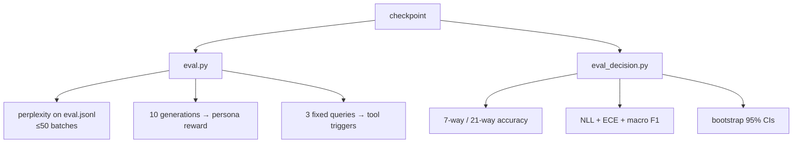

# Chapter 13 — Evaluation

> *A model can sound confident and still be wrong. Evaluation measures both the guesses and the confidence.*

---

## The 5-year-old analogy

After training, we give the crab three exams:

1. **Perplexity**: how surprised is it by a held-out conversation?
2. **Persona reward**: does a generated reply sound like a crab?
3. **Tool triggers**: does it call the right helper for obvious questions?

A second evaluator checks the tiny decision brain: accuracy, log loss, calibration error, macro F1, and confidence intervals from resampling.



---

## The main dashboard: `scripts/eval.py`

`run_eval()` (`scripts/eval.py:29-80`) computes three numbers.

### 1. Perplexity proxy

`eval.py:38-46`:

```python
38:    tot, n = 0, 0
39:    with torch.no_grad():
40:        for x, y, mask in loader:
41:            logits, _ = model(x)
42:            tot += compute_loss(logits, y, mask).item()
43:            n += 1
44:            if n >= 50:
45:                break
46:    ppl = math.exp(tot / max(1, n))
```

```
perplexity = exp(mean masked cross-entropy over at most 50 batches)
```

Lower is better. `eval_out/report.json` records **1.929**. That implies an average per-token loss of:

```
ln(1.929) = 0.6570
```

The shipped best checkpoint's stored eval loss is 0.6541 → `exp(0.6541) = 1.9234`. The small difference comes from different eval runs and batch counts.

### 2. Persona reward on generations

`eval.py:47-69` deliberately scores **generated** replies, not reference texts, so checkpoints are comparable:

```python
63:        for prompt in prompts:
64:            ids = tokenizer.encode(format_prompt(prompt)).ids[-mc.max_seq_len + 64 :]
65:            idx = torch.tensor([ids], dtype=torch.long)
66:            out = model.generate(idx, max_new_tokens=48, temperature=0.6, top_k=20)
67:            gen = tokenizer.decode(out[0].tolist()[len(ids):]).strip()
68:            rewards.append(score_response(gen))
69:    avg_r = sum(rewards) / max(1, len(rewards))
```

Ten held-out prompts, 48 tokens each, temperature 0.6, top-k 20. Chapter 11 defines `score_response`.

Current `eval_out/report.json`: **0.378**.

### 3. Tool trigger rate

`eval.py:71-73` uses three fixed queries without network access:

```python
71:    checks = ["integrate x^2", "latest AI news", "hello crab"]
72:    tool_ok = sum(1 for q in checks if _offline_tool_trigger(q))
73:    report = {"perplexity_proxy": round(ppl, 3), "avg_persona_reward": round(avg_r, 3), ...}
```

Result: **2/3**. The greeting is expected to stay in chat mode, so 2/3 is the good outcome.

### Report comparison

| Checkpoint | Perplexity | Persona reward | Tool triggers |
|---|---:|---:|---:|
| SFT current (`eval_out/report.json`) | 1.929 | 0.378 | 2/3 |
| SFT in `README.md:145` | 1.931 | 0.495 | — |
| PPO | 1.992 | 0.648 | 2/3 |
| DPO v2 | 1.930 | 0.449 | 2/3 |
| DPO final | 1.929 | 0.487 | 2/3 |

Persona reward varies by about ±0.05 because it is sampled over only 10 generations.

---

## Decision-model evaluation: `scripts/eval_decision.py`

This script has two methods.

### Logit method

Uses the model's own next-token logits at constrained option-token IDs (`decision_model.py:81-95`). It now averages two rotated class-to-letter assignments by default; a temperature is fitted on the calibration split, then applied to the test split.

`eval_out/decision/report.json`:

| Metric | Uncalibrated (T=1) | Calibrated (T=3) |
|---|---:|---:|
| Accuracy | 0.214 | 0.214 |
| NLL | 1.9497 | 1.9455 |
| ECE | 0.0440 | 0.0624 |
| Macro F1 | 0.0847 | — |

Support sums to 1,000: `a=144, b=167, c=100, d=163, e=120, f=100, g=206`.

The ECE calculation: all rows fall in one confidence bin with mean confidence 0.17 and accuracy 0.214, so `ECE = |0.17 − 0.214| = 0.044`. After calibration the mean confidence drops to 0.1516 and ECE rises to 0.0624, even though NLL improves. One metric can improve while another gets worse.

### Probe method

Uses the frozen linear heads (chapter 10). `scripts/eval_decision.py:273-385` applies the shipped
label-free prior (`log p − λ log π`, λ = 0.5), refits temperatures on the calibration half, sweeps
a confused threshold, and reports the disjoint test half.

`eval_out/decision_probe/report.json`:

| Metric | Value |
|---|---:|
| Rows used for fitting | 1,000 (`n_cal`) |
| Test rows | 4,000 |
| Accuracy | 1.000 |
| NLL | 0.000 |
| ECE | 0.000 |
| Macro F1 | 1.000 |
| Confused threshold | 0.3 |
| Confused precision / recall | 1.0 / 1.0 |
| Confused support | 268 |
| 21-way accuracy | 0.9982 |
| 21-way macro F1 | 0.9971 |

All 4,000 test rows land in the `(0.90, 1.00]` confidence bin. These numbers come from template-generated data and flatter the model.

### Option-order robustness (zero-shot)

`DecisionModel.predict()` rotates which class each display letter names and averages two evenly
spaced passes. `_order_flip_rate()` (`eval_decision.py:118-156`) re-runs the prediction after
permuting the assignment by three letters and counts how often the predicted class changes.

```bash
python scripts/eval_decision.py --method logit --max-n 400 --cal-n 200 \
  --bootstrap 0 --out-dir eval_out/decision_order
```

| Variant | Order-flip rate |
|---|---:|
| raw (1 pass) | 1.0000 |
| L0 (2 passes) | **0.6025** |

The raw model nearly always picks the first display letter, so a re-labelling flips almost every
prediction. Rotation spreads the letter bias across classes. The probe path uses one fixed prompt
and reports `rotations: 1`.

### Human eval

`data/human_eval.jsonl` has 126 hand-written messages: 21 fine types × 6. The command from the README:

```bash
python scripts/eval_decision.py --eval data/human_eval.jsonl --method probe \
  --max-n 126 --cal-n 60 --out-dir eval_out/human
```

Results in the README:

| Metric | Value |
|---|---:|
| 7-way accuracy | 0.6212 |
| 7-way macro F1 | 0.6075 |
| 21-way accuracy | 0.4848 |
| 21-way macro F1 | 0.4199 |

With `n_cal = min(60, 126//2) = 60`, the test set has 66 rows. `0.6212 × 66 ≈ 41` and `0.4848 × 66 ≈ 32`, so the reported accuracies correspond to about 41/66 and 32/66 correct.

---

## Metric formulas

All from `hermitlm/tools/metrics.py:26-74` (chapter 10 covered ECE and macro F1 in detail).

### Accuracy

```
accuracy = (1/n) Σ_i 1[argmax p_i == y_i]
```

### Negative log likelihood

```
NLL = −(1/n) Σ_i log( clamp(p_i[y_i], 1e−12) )
```

Clamping avoids infinite loss when the correct class gets probability 0.

### Per-class precision, recall, F1

```
tp_c = Σ_i 1[y_i == c and pred_i == c]
fp_c = Σ_i 1[y_i != c and pred_i == c]
fn_c = Σ_i 1[y_i == c and pred_i != c]
P_c  = tp_c / (tp_c + fp_c)      (0 if denominator is 0)
R_c  = tp_c / (tp_c + fn_c)
F1_c = 2 P_c R_c / (P_c + R_c)
macro F1 = (1/K) Σ_c F1_c
```

### Bootstrap interval

```
for b in 1..n_boot:
    draw n sample indices with replacement
    statistic_b = statistic(sample)
CI = [percentile 2.5, percentile 97.5]
```

Defaults: `n_boot = 2000` in `metrics.py:81-83`, 1,000 in the eval script. The paired version computes `stat_calibrated − stat_uncalibrated` on identical draws, giving a tighter interval for the improvement.

### Confusion threshold sweep

`eval_decision.py:332-343` tries `[0.3, 0.5, 0.7, 0.8, 0.9, 0.95]` and keeps the threshold with the best binary F1:

```
F1 = 2 tp / (2 tp + fp + fn)
```

The shipped confused detector selected 0.3 on template data. The runtime uses a fixed 0.9 for escalation (`settings.py:20`).

---

## Worked calculation: macro F1 for the zero-shot path

Supports and F1 values inferred from `eval_out/decision/report.json`:

```
accuracy = 214/1000 = 0.214
only classes f and g score above zero:
  class f F1 ≈ 0.2095
  class g F1 ≈ 0.3837
macro F1 = (0+0+0+0+0+0.2095+0.3837)/7 = 0.5932/7 = 0.08474 → 0.0847
```

This matches the report. Macro F1 punishes the five classes the zero-shot prompt never predicts.

---

## Other evaluation scripts

| Script | Purpose |
|---|---|
| `scripts/build_human_eval.py` | Writes 126 hand-written rows from `HUMAN_EVAL` |
| `scripts/build_tool_data.py` | Writes 5,038 tool-train and 80 tool-eval rows; checks train/eval overlap |
| `scripts/eval_decision.py` | Accuracy, NLL, ECE, F1, bins, paired bootstrap, confusion CI, order-flip rate |
| `scripts/eval.py` | Perplexity, persona reward, tool triggers |
| `python -m hermitlm.tools.check` | Pre-deploy artifact and token checks |

`build_tool_data.py:400-403` raises `ValueError` if any eval query also appears in training, so the tool probe cannot memorize the test set.

---

## Caveats to remember

1. README numbers and `eval_out/*.json` numbers come from different runs. Prefer the JSON files for exact values.
2. PPO and DPO results predate the current corpus and were not rerun.
3. The probe's near-perfect template scores do not transfer to human phrasing: 1.000 → 0.6212 on 126 hand-written rows.
4. `eval_out/human/` is not checked in, so the human-eval numbers exist only in the README.
5. `eval_out/decision/report.json` uses an older script format with a `grid` key; current runs report `n = rows − n_cal`.
6. The order-flip report is zero-shot only; the shipped router uses the supervised probe, which does not rotate.

---

## Math and calculations

### From loss to perplexity

```
loss     = 0.6540815
PPL      = e^0.6540815 = 1.9234
per-token surprise = 0.6541 nats ≈ 0.943 bits
```

### Tool probe accuracy from per-class counts

```
(0.80×20 + 0.65×20 + 0.60×20 + 0.85×20) / 80
= (16 + 13 + 12 + 17) / 80
= 58/80 = 0.725
```

### Human eval test size

```
n_cal = min(60, 126 // 2) = 60
test  = 126 − 60 = 66
```

---

## Code you should remember

| File and lines | What it does |
|---|---|
| `scripts/eval.py:38-46` | Perplexity proxy |
| `scripts/eval.py:47-73` | Generation reward and offline tool checks |
| `scripts/eval_decision.py:158-200` | Metric summary and bootstrap CIs |
| `scripts/eval_decision.py:273-385` | Probe evaluation path (with prior) |
| `scripts/eval_decision.py:332-343` | Confusion threshold sweep |
| `scripts/eval_decision.py:118-156` | Zero-shot order-flip report |
| `hermitlm/tools/metrics.py:26-120` | All metric implementations |

---

**Next:** [Chapter 14 — Glossary and formula sheet](14_glossary_math.md)
